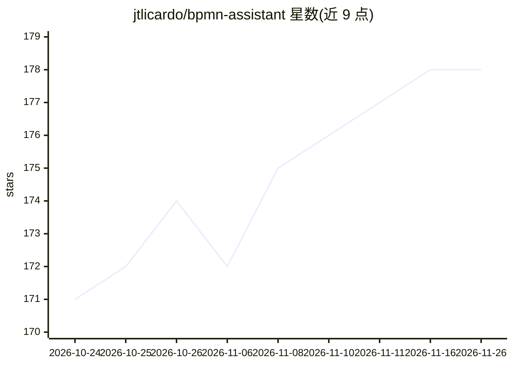

# jtlicardo/bpmn-assistant

⭐ 178 · Python · MIT · 推送 2026-11-12 · [GitHub](https://github.com/jtlicardo/bpmn-assistant) · [官网](https://bpmn-frontend.onrender.com) · 个人维护

**用自然语言对话生成与编辑 BPMN 流程图的开源助手**

该应用将业务流程的自然语言描述转换为可编辑的 BPMN 图：生成任务、网关、事件、池、泳道与消息流等元素，支持对话式修改、拖拽导入 BPMN 文件、用图片创建或修改流程，并可在可视化编辑器中调整后导出 .bpmn 文件。提供托管版与 Docker 本地部署两种方式，需自备 OpenAI 或 Anthropic API key。README 列明支持的 BPMN 元素子集，并注明助手无法感知用户对图的手动修改。附有研究论文链接。

## 筛选速览

| 维度 | 判定 | 备注 |
|---|---|---|
| AI 角色 | `ai-native` | 本体是模型或模型工具 |
| 许可风险 | `permissive` | MIT |
| 部署形态 | `self-host` | docker 或自建部署 |
| 模型依赖 | locked-api |  |
| 硬件要求 | — | 无带数字的原话,不猜 |
| 安装摩擦 | `low` | 无编译、无系统依赖或容器化 |
| 成熟度 | — | 结构信号不足 |

## 能力要点

- 自然语言生成含池、泳道、消息流的 BPMN 图
- 对话式修改流程与问答式解读现有图
- 支持拖拽导入 BPMN 文件及图片输入
- 支持任务标记、嵌入子流程、边界事件等元素子集

## 适用场景

- 分析师用自然语言起草工作流程图
- 团队讨论流程改动并迭代生成图
- 学生学习 BPMN 建模并让模型解释流程
- 基于已有 BPMN 文件继续修改流程

## 场景标签

`聊天机器人` · 领域:对话与助手

## 证据(README 行号)

> L5: Describe a business process in plain language, refine it through conversation, and export a `.bpmn` file. An open-so
> L19: - **Describe your process.** Generate BPMN diagrams with tasks, gateways, events, pools, lanes, and message flows.
> L24: - **Run it your way.** Use the hosted app or run locally with Docker and your own API keys.

## 星数曲线

2026-10-24 171 → 2026-11-26 178（+7）

---
*卡片 v1 · prompt 1.4 · 生成 2026-11-26 · 置信度 high · 依据 README sha `a640f9ea9b99` · [字段定义](../../DATASET.md)*
