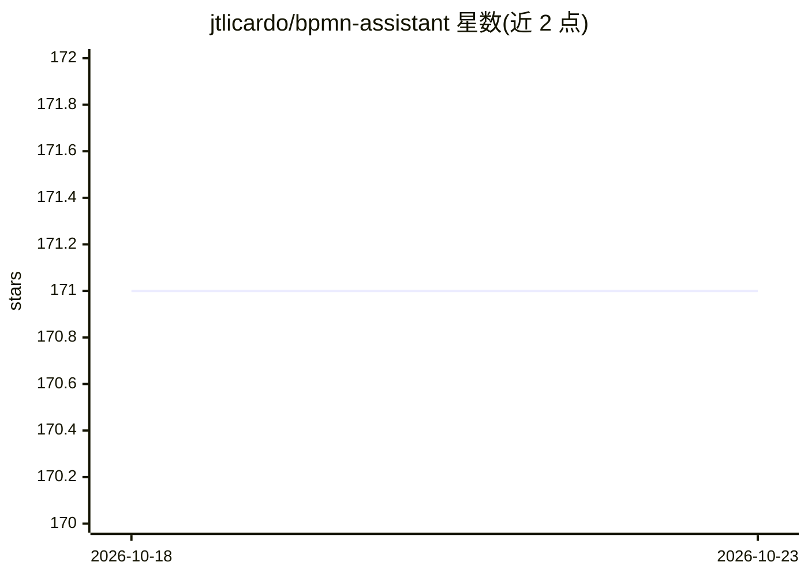

# jtlicardo/bpmn-assistant

⭐ 171 · Python · MIT · 推送 2026-10-06 · [GitHub](https://github.com/jtlicardo/bpmn-assistant) · [官网](https://bpmn-frontend.onrender.com) · 个人维护

**LLM 助手：把自然语言流程描述转成可编辑 BPMN 图**

面向流程分析师、团队与学生的应用：用户用自然语言描述业务流程，应用调用 OpenAI 或 Anthropic 模型生成含任务、网关、事件、泳道等 BPMN 元素的图，可对话式修改、导入既有 BPMN 文件或图片、问答解释流程，并在可视化编辑器中手动调整后导出 .bpmn 文件。提供托管版（自带 API key）或 Docker Compose 本地部署。限制：助手不感知手动编辑，仅基于其最后生成版本回应；不支持嵌套泳道。

## 筛选速览

| 维度 | 判定 | 备注 |
|---|---|---|
| AI 角色 | `ai-native` | 本体是模型或模型工具 |
| 许可风险 | `permissive` | MIT |
| 部署形态 | `self-host` | docker 或自建部署 |
| 模型依赖 | locked-api |  |
| 硬件要求 | — | 无带数字的原话,不猜 |
| 安装摩擦 | `low` | 无编译、无系统依赖或容器化 |
| 成熟度 | — | 结构信号不足 |

## 能力要点

- 自然语言生成含网关/事件/池/泳道/消息流的 BPMN 图并对话式修改
- 导入 BPMN 文件或图片创建或修改流程
- 对既有流程图问答式解释
- 托管版或 Docker Compose 本地部署，支持 GPT 与 Claude 模型

## 适用场景

- 用自然语言起草业务流程图并导出 .bpmn 文件
- 团队讨论流程变更时对话式迭代修改图
- 导入既有流程图提问理解其运作方式

## 场景标签

`代码生成` `文档问答` · 领域:编码与开发

## 证据(README 行号)

> L5: Describe a business process in plain language, refine it through conversation, and export a `.bpmn` file. An open-so
> L19: - **Describe your process.** Generate BPMN diagrams with tasks, gateways, events, pools, lanes, and message flows.
> L34: Open the **hosted app**, enter an API key, choose a model, and try this prompt:

## 星数曲线

2026-10-18 171 → 2026-10-23 171（+0）

---
*卡片 v1 · prompt 1.4 · 生成 2026-10-23 · 置信度 high · 依据 README sha `1bc68ce1c58c` · [字段定义](../../DATASET.md)*
