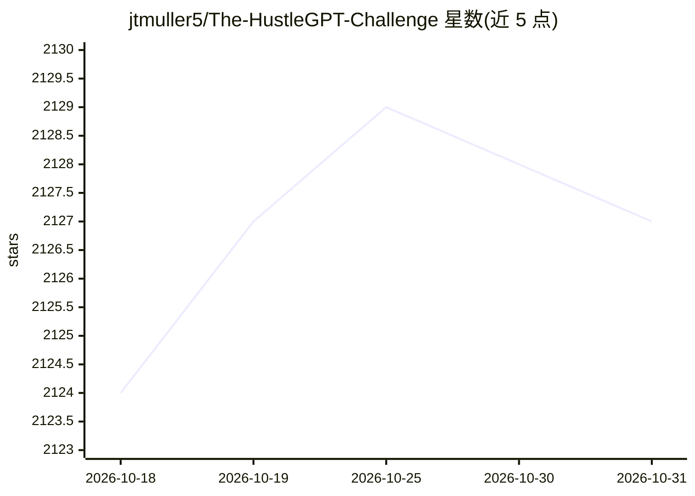

# jtmuller5/The-HustleGPT-Challenge

⭐ 2,127 · 推送 2026-09-10 · [GitHub](https://github.com/jtmuller5/The-HustleGPT-Challenge) · [官网](https://sapidlabs.gumroad.com/l/abqwfw) · 个人维护

**HustleGPT 挑战项目策展清单：收录与 AI 共创的创业项目**

记录 2023 年 3 月 GPT-4 发布后由 @jacksonfall 发起的 HustleGPT 挑战的策展清单：参与者在 100 美元预算提示词下与 GPT-4 作为'AI 联合创始人'共建企业。清单按艺术、商业资源、ChatGPT 与 AI、教育等 16 个类别收录 202 个项目，标注创建者推特、营利/非营利状态与是否盈利（🟩）或停运（🪦）。仓库自 2023 年 6 月停止更新并归档，2026 年复查链接：可核查的 136 个站点中 56 个仍存活、75 个已消失、5 个被机器人拦截。另有一份 10 美元的配套指南。

## 筛选速览

| 维度 | 判定 | 备注 |
|---|---|---|
| AI 角色 | `ai-knowledge` | 知识聚合/清单类 |
| 许可风险 | `none` | — |
| 部署形态 | `None` |  |
| 模型依赖 | — | README 未给出锁定关系 |
| 硬件要求 | — | 无带数字的原话,不猜 |
| 安装摩擦 | `low` | 无编译、无系统依赖或容器化 |
| 成熟度 | — | 结构信号不足 |

## 能力要点

- 收录 202 个 HustleGPT 创业项目，按 16 个类别组织
- 含原始 HustleGPT 提示词与挑战背景说明
- 项目状态标记：营利/非营利/建设中/盈利 $1+/停运（2026 年链接复查）
- 总盈利项目 27 个

## 适用场景

- 查看 2023 年 GPT-4 创业潮中人们实际构建了哪些项目
- 研究 AI 协同创业的存活率与项目分布
- 追溯 HustleGPT 挑战与原始提示词的历史记录

## 场景标签

`精选清单` · 领域:学习与行业

## 证据(README 行号)

> L7: Curated list of HustleGPT endeavors.
> L30: The goal of the HustleGPT challenge is to build a business with an AI co-founder. In doing so you will learn an inc
> L66: > Current Total: 202

## 星数曲线

2026-10-18 2,124 → 2026-10-31 2,127（+3）

---
*卡片 v1 · prompt 1.4 · 生成 2026-10-21 · 置信度 high · 依据 README sha `51f5a641a997` · [字段定义](../../DATASET.md)*
