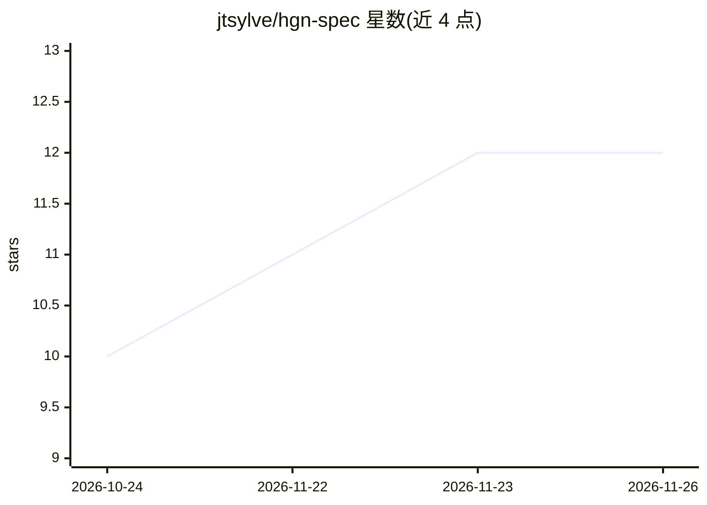

# jtsylve/hgn-spec

⭐ 12 · NOASSERTION · 推送 2026-10-08 · [GitHub](https://github.com/jtsylve/hgn-spec) · 个人维护

**halogen HGN 权重格式的净室规范文档集，面向推理引擎移植者**

对 halogen 推理引擎所用 HGN 权重文件格式的净室规范，含容器结构、张量表、存储编码（含 q4c/i4l/i4r/ht 等低比特量化）、GGUF 导入规则、数值语义、移植指南与字节级测试向量。证据来自 halogen-flash 0.16.2 读取器行为与已发布 checkpoint（9 文件 8,427 表项）的结构校验。文档不含任何 halogen 源码，依据其 EULA 的互操作条款编写；27B 引擎未做分析，仅由已发布文件推导规则。

## 筛选速览

| 维度 | 判定 | 备注 |
|---|---|---|
| AI 角色 | `ai-knowledge` | 知识聚合/清单类 |
| 许可风险 | `none` | NOASSERTION |
| 部署形态 | `None` |  |
| 模型依赖 | — | README 未给出锁定关系 |
| 硬件要求 | — | 无带数字的原话,不猜 |
| 安装摩擦 | `low` | 无编译、无系统依赖或容器化 |
| 成熟度 | — | 结构信号不足 |

## 能力要点

- 净室规范：仅描述字节、数值与行为，不含实现引用
- 含字节级测试向量与 GGUF→HGN 导入规则
- 低比特格式：codebook（NF4/NVFP4/Q4_0 等）与 Hadamard 旋转编码
- 所有规则附证据来源与置信度说明

## 适用场景

- 为其他推理引擎添加 HGN 读取支持
- 将 GGUF 权重转换为 HGN 张量
- 实现 HGN 格式的写入器或导入器

## 场景标签

 · 领域:LLM 基础设施/格式规范

## 证据(README 行号)

> L16: This document set is a clean-room specification. It describes bytes, values
> L19: inference engine.
> L31: |Porting guide|Integration plan, kernel design, memory residency and qualification for any engine|

## 星数曲线

2026-10-24 10 → 2026-11-26 12（+2）

---
*卡片 v1 · prompt 1.4 · 生成 2026-11-19 · 置信度 high · 依据 README sha `41cc6886533e` · [字段定义](../../DATASET.md)*
