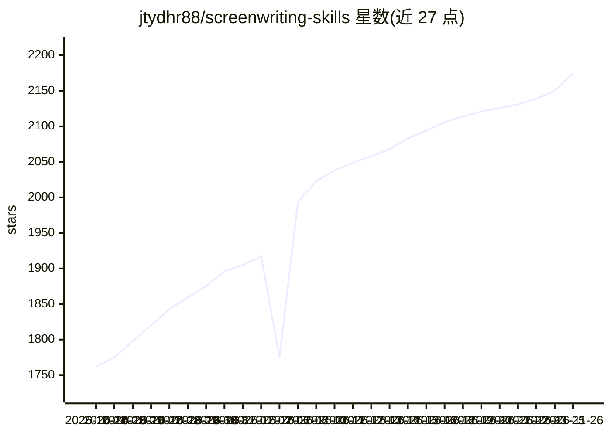

# jtydhr88/screenwriting-skills

⭐ 2,175 · Python · MIT · 推送 2026-11-24 · [GitHub](https://github.com/jtydhr88/screenwriting-skills) · 个人维护 · 中文 README

**面向编剧/影视写作的 27 个 agent 技能合集**

从 47 本写作技法书籍与 23 卷已出版剧本、乐谱、戏剧（中、美、英、日、韩）中提炼出 27 个 agent 技能，遵循开放的 agentskills.io 标准，可在 Claude Code 与 OpenAI Codex 中共用同一套文件，支持插件市场或 git clone 后复制到 skills 目录安装。技能正文以中文撰写，输出语言跟随提问语言，术语表将概念映射回英文原词。技能按四层组织：通用剧作法、媒介层（剧集/舞台/戏曲）、传统与行业、大师语料。

## 筛选速览

| 维度 | 判定 | 备注 |
|---|---|---|
| AI 角色 | `ai-knowledge` | 知识聚合/清单类 |
| 许可风险 | `permissive` | MIT |
| 部署形态 | `None` |  |
| 模型依赖 | — | README 未给出锁定关系 |
| 硬件要求 | — | 无带数字的原话,不猜 |
| 安装摩擦 | `low` | 无编译、无系统依赖或容器化 |
| 成熟度 | — | 结构信号不足 |

## 能力要点

- 27 个技能来自 47 本技法书与 23 卷出版剧本/戏剧
- 遵循 agentskills.io 开放标准，Claude Code 与 Codex 共用一套文件
- 单一中文源树，运行时按提问语言输出，术语锚定英文原词
- 四层组织：通用剧作法/媒介层/传统与行业/大师语料

## 适用场景

- 用 agent 把 12 集剧集拆分为幕并安排出幕点
- 为电影或舞台项目生成 premise→structure→scenes 的工作流程产出
- 按行业标准格式校对剧本排版与修订流程

## 场景标签

`提示工程` · 领域:Agent 开发

## 证据(README 行号)

> L5: 27 agent skills (for Claude Code and OpenAI Codex) for screenwriting, television writing and dramaturgy, distilled f
> L7: The skill files follow the open agentskills.io standard and are shared by both agents: install once and it works in 
> L104: 1. General dramaturgy   premise · structure · character · character bio · dialogue · scene · format · Truby organi

## 星数曲线

2026-10-24 1,762 → 2026-11-26 2,175（+413）

---
*卡片 v1 · prompt 1.4 · 生成 2026-11-26 · 置信度 high · 依据 README sha `10d9c6c8496b` · [字段定义](../../DATASET.md)*
