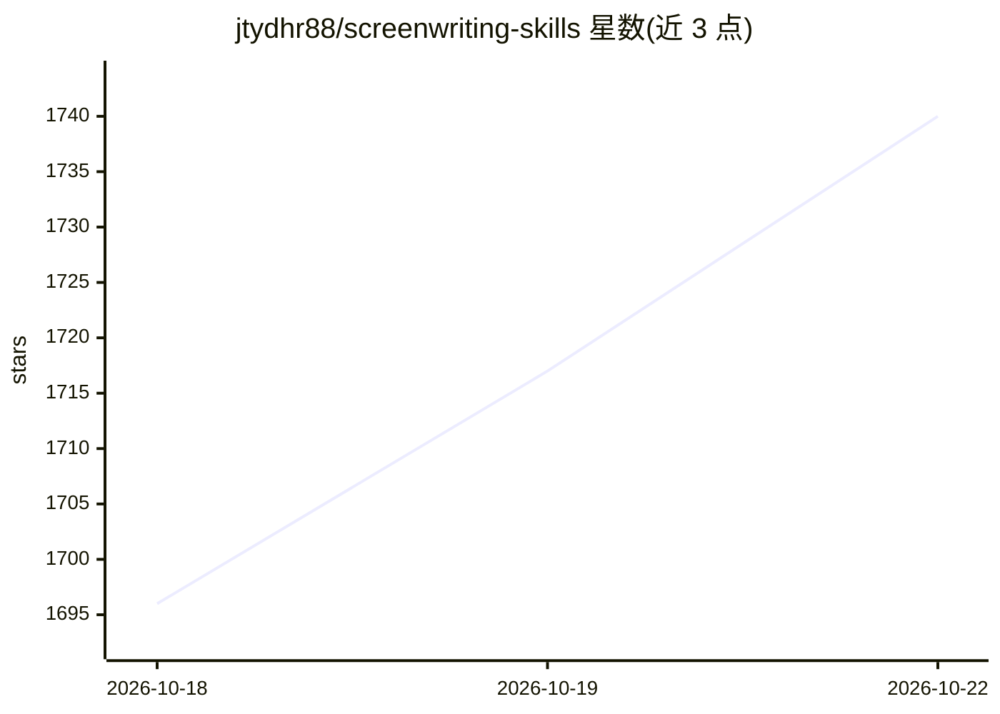

# jtydhr88/screenwriting-skills

⭐ 1,756 · Python · MIT · 推送 2026-10-03 · [GitHub](https://github.com/jtydhr88/screenwriting-skills) · 个人维护 · 中文 README

**面向影视编剧与戏剧创作的 26 个 agent 技能库**

为 Claude Code 与 OpenAI Codex 提供的 26 个编剧技能文件（SKILL.md 格式，遵循 agentskills.io 标准，双 agent 共用同一套安装）。内容从 47 本剧作书与 23 卷出版剧本/乐谱/戏剧提炼，按四层组织：通用剧作法、媒介层（剧集/舞台/戏曲）、传统与行业、大师语料（契诃夫/小津/《继承之战》等）。技能正文以中文写成，运行时按提问语言输出；曾有的英文平行版本已删除以避免多语言分叉维护。通过插件市场或 git clone 安装。

## 筛选速览

| 维度 | 判定 | 备注 |
|---|---|---|
| AI 角色 | `ai-knowledge` | 知识聚合/清单类 |
| 许可风险 | `permissive` | MIT |
| 部署形态 | `None` |  |
| 模型依赖 | — | README 未给出锁定关系 |
| 硬件要求 | — | 无带数字的原话,不猜 |
| 安装摩擦 | `low` | 无编译、无系统依赖或容器化 |
| 成熟度 | — | 结构信号不足 |

## 能力要点

- 26 个技能覆盖剧作结构、人物、对白、场景、类型解剖与剧集创作室流程
- 提炼自 47 本剧作书与 23 卷出版剧本（中/美/英/日/韩）
- 单一中文源树，运行时按提问语言交付输出并锚定原文术语
- 兼容 Claude Code 与 OpenAI Codex，一次安装双 agent 可用

## 适用场景

- 为长篇剧集拆分幕结构并安排 act out 位置
- 在 Claude Code 或 Codex 中调用剧作法技能辅导剧本创作
- 建立并维护跨会话的故事圣经（story bible）

## 场景标签

`AI 写作` `提示工程` · 领域:Agent 开发

## 证据(README 行号)

> L5: 26 agent skills (for Claude Code and OpenAI Codex) for screenwriting, television writing and dramaturgy, distilled f
> L7: The skill files follow the open agentskills.io standard and are shared by both agents: install once and it works in 
> L99: ## How the skills are organised

## 星数曲线

2026-10-18 1,696 → 2026-10-22 1,740（+44）

---
*卡片 v1 · prompt 1.4 · 生成 2026-10-21 · 置信度 high · 依据 README sha `6b884a936078` · [字段定义](../../DATASET.md)*
