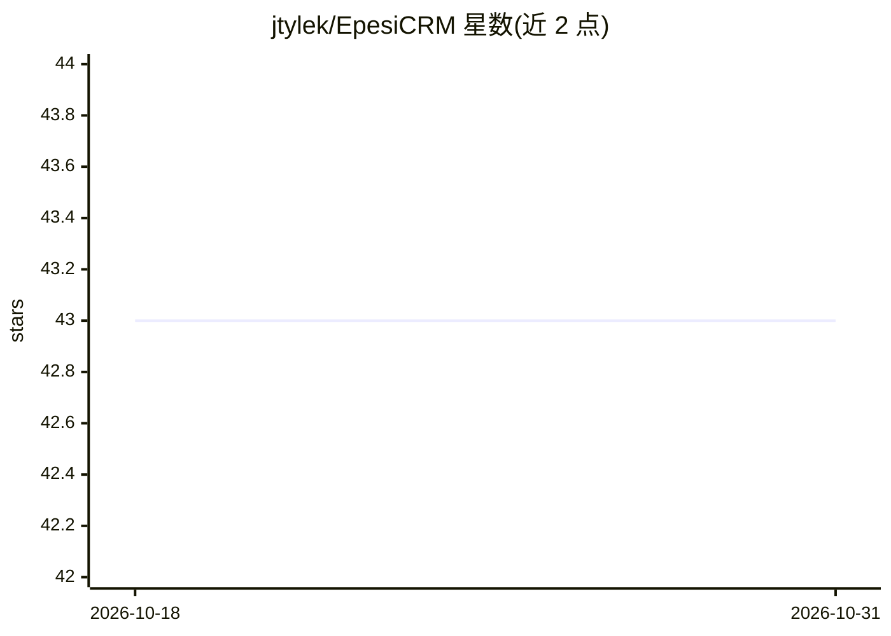

# jtylek/EpesiCRM

⭐ 43 · PHP · NOASSERTION · 推送 2026-10-27 · [GitHub](https://github.com/jtylek/EpesiCRM) · [官网](https://epesicrm.com) · 个人维护

**基于 Laravel 的开源模块化 CRM，可作自建 ERP 起点**

自托管、MIT 许可的 CRM，基于 Laravel 12 + Filament 5 完全重写：集中管理公司、联系人、任务、会议、通话、邮件、共享日历与笔记附件，支持角色权限、字段级变更历史、浏览器添加自定义字段、客户门户、模块化安装（Epesi Store）及 13 种语言。RecordBrowser 引擎根据字段声明自动生成列表/查看/编辑界面，模块可作为自建 ERP 的起点。面向终端用户提供 SourceForge 免 Composer 安装包，面向开发者提供 git clone + Composer/npm 构建流程。

## 筛选速览

| 维度 | 判定 | 备注 |
|---|---|---|
| AI 角色 | `ai-enhanced` | 去掉 AI 部分产品仍成立 |
| 许可风险 | `none` | NOASSERTION |
| 部署形态 | `library` | 以包/库形式分发 |
| 模型依赖 | — | README 未给出锁定关系 |
| 硬件要求 | — | 无带数字的原话,不猜 |
| 安装摩擦 | `low` | 无编译、无系统依赖或容器化 |
| 成熟度 | — | 结构信号不足 |

## 能力要点

- 模块化架构（modules/<Vendor>/<Name>），运行时装卸，可扩展为自建 ERP
- RecordBrowser 由字段声明自动生成增删改查界面与筛选搜索
- 终端用户免 Composer/Node，浏览器向导式安装，兼容共享主机
- 字段级全量变更历史、自定义字段、客户门户、13 种语言

## 适用场景

- 小团队自托管一套免费无按席位收费的 CRM 管客户与日程
- 以现有 CRM 为起点按需加模块搭自建 ERP
- 从旧版 Epesi 迁移含编辑历史的存量数据

## 场景标签

 · 领域:企业管理软件（CRM/ERP）

## 证据(README 行号)

> L3: Free, open-source CRM built on **Laravel 12 + Filament 5**, and a kickstarter for your own ERP
> L120: **Tip:** ScreenCapture is a handy utility for sending
> L174: - AGENTS.md: the rules for working in this repository, for people and AI agents

## 星数曲线

2026-10-18 43 → 2026-10-31 43（+0）

---
*卡片 v1 · prompt 1.4 · 生成 2026-10-25 · 置信度 low · 依据 README sha `4b96218cbc6b` · [字段定义](../../DATASET.md)*
