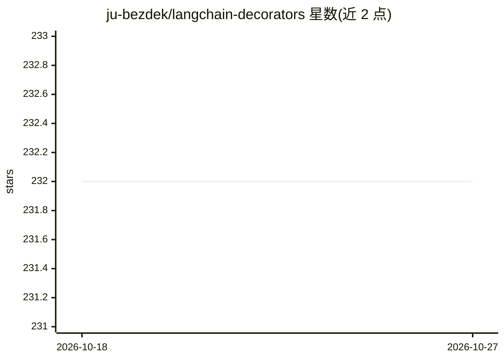

# ju-bezdek/langchain-decorators

⭐ 232 · Python · MIT · 推送 2026-04-18 · [GitHub](https://github.com/ju-bezdek/langchain-decorators) · 个人维护

**LangChain 之上的提示词/链编写装饰器语法糖库**

构建在 LangChain 之上的轻量 Python 层，用 @llm_prompt 装饰器将函数 docstring 定义为提示词模板，函数签名即输入参数。支持多角色消息块、可选段落、按返回类型自动选择输出解析器（list/dict/Pydantic）、LlmChatSession 会话、@llm_function 工具调用（含动态 schema）、流式与结构化输出，并集成 LangSmith 追踪标签。自声明为非官方附加层，通过 pip 安装，面向使用 LangChain 的开发者。

## 筛选速览

| 维度 | 判定 | 备注 |
|---|---|---|
| AI 角色 | `ai-ecosystem` | LLM/agent 周边工具 |
| 许可风险 | `permissive` | MIT |
| 部署形态 | `library` | 以包/库形式分发 |
| 模型依赖 | — | README 未给出锁定关系 |
| 硬件要求 | — | 无带数字的原话,不猜 |
| 安装摩擦 | `low` | 无编译、无系统依赖或容器化 |
| 成熟度 | — | 结构信号不足 |

## 能力要点

- @llm_prompt 装饰器以函数 docstring 定义多角色提示词模板
- 按返回类型自动选择输出解析器，支持 Pydantic 结构化输出
- @llm_function 简化工具调用并支持动态 schema 生成
- StreamingContext 流式输出与 LangSmith 追踪集成

## 适用场景

- 用更 Pythonic 的方式编写和管理 LangChain 提示词
- 在函数签名中声明提示词参数并保留 IDE 提示与类型检查
- 简化 LangChain 的工具调用与聊天会话管理

## 场景标签

`提示工程` · 领域:Agent 开发

## 证据(README 行号)

> L3: LangChain Decorators is a lightweight layer built on top of LangChain that provides syntactic sugar 🍭 for writing cu
> L5: > Note: This is an unofficial add-on to the LangChain library. It is not trying to compete—just to make using it eas

## 星数曲线

2026-10-18 232 → 2026-10-27 232（+0）

---
*卡片 v1 · prompt 1.4 · 生成 2026-10-22 · 置信度 high · 依据 README sha `0d20826a3cce` · [字段定义](../../DATASET.md)*
