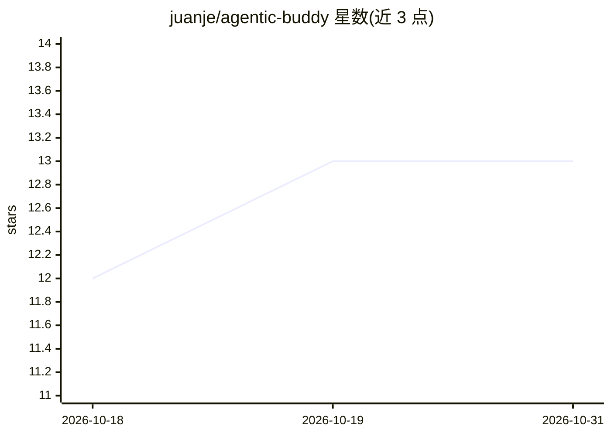

# juanje/agentic-buddy

⭐ 13 · Python · MIT · 推送 2026-10-13 · [GitHub](https://github.com/juanje/agentic-buddy) · 个人维护

**给 AI agent 用的自组织记忆系统模板，自动归档任务与知识**

一个以目录结构实现的 agent 记忆模板：克隆仓库后在 Cursor/Claude Code 等 AI 编辑器中打开，通过 /setup 引导配置。系统分四个记忆区（CLAUDE.md 工作记忆、agent_brain 语义记忆、logs 情景记忆、user 用户工作区），由 hook 驱动编码、巩固、校准、遗忘四级学习循环，用 Hebbian 式使用度升降管理知识文件。支持领域包（work/personal/writing）按需启用。README 声明为早期项目，无稳定 API，结构可能变动。

## 筛选速览

| 维度 | 判定 | 备注 |
|---|---|---|
| AI 角色 | `ai-ecosystem` | LLM/agent 周边工具 |
| 许可风险 | `permissive` | MIT |
| 部署形态 | `None` |  |
| 模型依赖 | — | README 未给出锁定关系 |
| 硬件要求 | — | 无带数字的原话,不猜 |
| 安装摩擦 | `low` | 无编译、无系统依赖或容器化 |
| 成熟度 | `idea` | |

## 能力要点

- 四记忆区架构：工作记忆/语义记忆/情景记忆/用户工作区，各区独立生命周期
- 编码→巩固→校准→遗忘四级自动学习循环（hook 触发，无需手动干预）
- Hebbian 式知识升降级：按使用频率提升/冷却文件可见度
- work/personal/writing 三种领域启动包，/update 可拉取上游结构更新且不动用户数据

## 适用场景

- 把任务、决策、想法口头倾倒给 agent，由其自动分类归档
- 让长期使用的 agent 积累个人/项目知识并在会话启动时自动注入上下文
- 管理工作看板、GTD 收件箱或写作素材等个人生产力场景

## 场景标签

`Agent 记忆` `知识库管理` · 领域:Agent 开发

## 证据(README 行号)

> L47: |`CLAUDE.md`|Working memory|Active context, rules, skills index|Updated by `/daily` and `/weekly`|Agent|
> L165: The system uses `CLAUDE.md` as its single entry point — supported by both Cursor and Claude Code natively:

## 星数曲线

2026-10-18 12 → 2026-10-31 13（+1）

---
*卡片 v1 · prompt 1.4 · 生成 2026-10-31 · 置信度 high · 依据 README sha `562dcf40eefd` · [字段定义](../../DATASET.md)*
