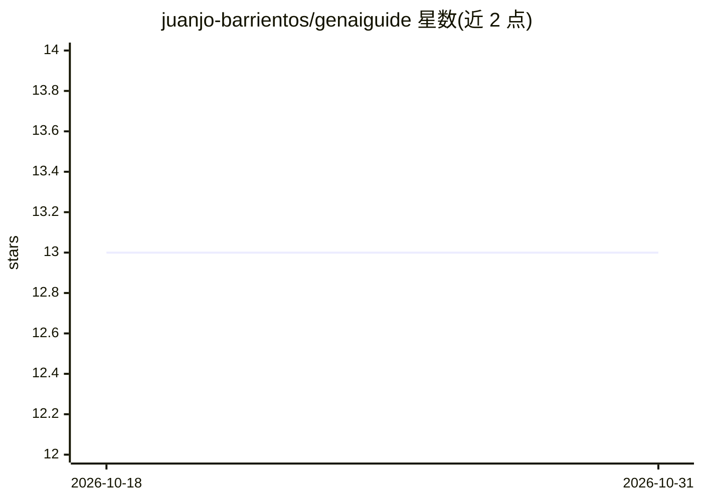

# juanjo-barrientos/genaiguide

⭐ 13 · CC0-1.0 · 推送 2026-10-02 · [GitHub](https://github.com/juanjo-barrientos/genaiguide) · 个人维护

**西班牙语生成式 AI 进阶免费学习指南（311 页 PDF）**

一部 311 页的西班牙语免费指南，讲解现代生成式模型内部机制而非仅 API 调用，覆盖 Transformer、后训练（LoRA/RLHF/DPO）、高效架构、推理与 GPU 系统、扩散与智能体、安全与可解释性等六部分，末附西英对照术语表。正文由 Claude Opus 5.5 起草、作者人工审阅，作者声明非同行评审文本、可能含错误。图表由真实计算生成，章节代码经过运行验证。CC0 公有领域许可，可免费下载 PDF。

## 筛选速览

| 维度 | 判定 | 备注 |
|---|---|---|
| AI 角色 | `ai-knowledge` | 知识聚合/清单类 |
| 许可风险 | `viral` | CC0-1.0 |
| 部署形态 | `None` |  |
| 模型依赖 | — | README 未给出锁定关系 |
| 硬件要求 | — | 无带数字的原话,不猜 |
| 安装摩擦 | `low` | 无编译、无系统依赖或容器化 |
| 成熟度 | — | 结构信号不足 |

## 能力要点

- 311 页西语指南，覆盖从 Transformer 到推理系统与智能体的六大部分
- 含数学推导独立框与实践框，图表由真实计算生成
- 章节代码经运行验证，附西英术语表
- CC0 许可，允许商用且无需署名

## 适用场景

- 系统自学生成式 AI 进阶主题（后训练、推理、扩散等）
- 作为西语读者阅读英文论文前的参考与术语对照
- 了解 Transformer、MoE、量化、分布式训练等专题的实践要点

## 场景标签

`教程课程` · 领域:学习与行业

## 证据(README 行号)

> L4: Guía gratuita de 311 páginas para entender cómo funcionan por dentro los modelos generativos modernos, no solo cómo 
> L14: |I. Fundamentos|El Transformer desde cero, leyes de escalamiento, ciencia de la evaluación, incertidumbre y predicc

## 星数曲线

2026-10-18 13 → 2026-10-31 13（+0）

---
*卡片 v1 · prompt 1.4 · 生成 2026-10-31 · 置信度 high · 依据 README sha `2a2cfc2869d2` · [字段定义](../../DATASET.md)*
