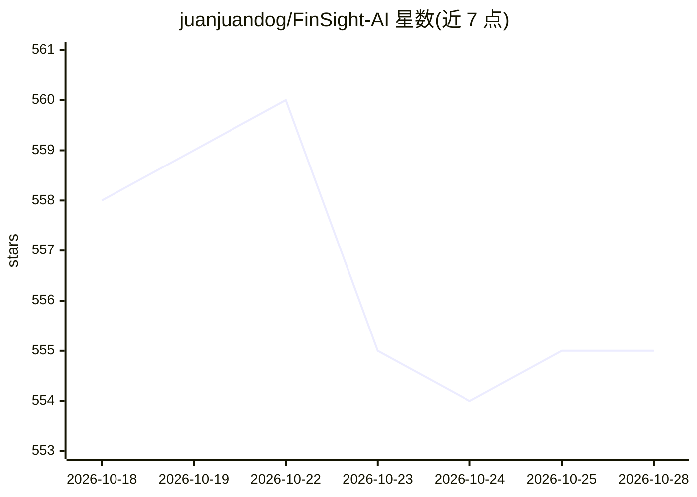

# juanjuandog/FinSight-AI

⭐ 555 · Java · MIT · 推送 2026-09-02 · [GitHub](https://github.com/juanjuandog/FinSight-AI) · 个人维护 · 中文 README

**A股公司研究的开源工作台：可恢复工作流与证据可溯 RAG 报告**

面向 A 股研究的开源工作区与后端工程参考：将行情数据、财务指标、公告与公司事件转为结构化 AI 研究结论，报告绑定数据快照哈希与证据链路可复现。核心机制包括可恢复的工作流编排（RabbitMQ 任务状态机、重试与死信）、Redis 幂等/单飞租约、PostgreSQL/pgvector 混合检索（全文+向量+RRF+重排）、FastAPI AI 边车（Ollama 默认、OpenAI 兼容与 Anthropic 适配器、确定性降级）。提供轻量本地预览与 Docker Compose 全栈两种运行方式；不做自动交易，输出非投资建议。

## 筛选速览

| 维度 | 判定 | 备注 |
|---|---|---|
| AI 角色 | `ai-native` | 本体是模型或模型工具 |
| 许可风险 | `permissive` | MIT |
| 部署形态 | `self-host` | docker 或自建部署 |
| 模型依赖 | local-ok | 支持本地模型 |
| 硬件要求 | — | 无带数字的原话,不猜 |
| 安装摩擦 | `low` | 无编译、无系统依赖或容器化 |
| 成熟度 | — | 结构信号不足 |

## 能力要点

- 长任务可恢复：显式任务状态、重试、超时接管与死信处理
- 报告绑定 dataSnapshotHash/reportVersion，结论保留可检查的证据链
- 混合检索：全文+向量召回、RRF 融合、重排序与回归评估
- AI 边车支持 Ollama（默认本地）/OpenAI 兼容/Anthropic，模型不可用时确定性降级

## 适用场景

- 搜索 A 股公司并生成带证据与风险因素的结构化研究结论
- 核验 AI 报告所依赖的公告与财务数据快照
- 作为可靠 AI agent 后端工程（工作流恢复、幂等、RAG 评估）的参考实现

## 场景标签

`RAG` `金融量化` `工作流自动化` · 领域:效率与自动化

## 证据(README 行号)

> L22: FinSight AI is an open-source A-share research workspace and a backend engineering reference for reliable AI agents
> L33: |AI Analysis|Generate a structured conclusion with confidence, supporting factors, and risk factors|
> L45: |RAG answers are difficult to verify|Full-text and vector recall, reciprocal-rank fusion, reranking, evidence trace

## 星数曲线

2026-10-18 558 → 2026-10-28 555（-3）

---
*卡片 v1 · prompt 1.4 · 生成 2026-10-21 · 置信度 high · 依据 README sha `090ae0413e06` · [字段定义](../../DATASET.md)*
