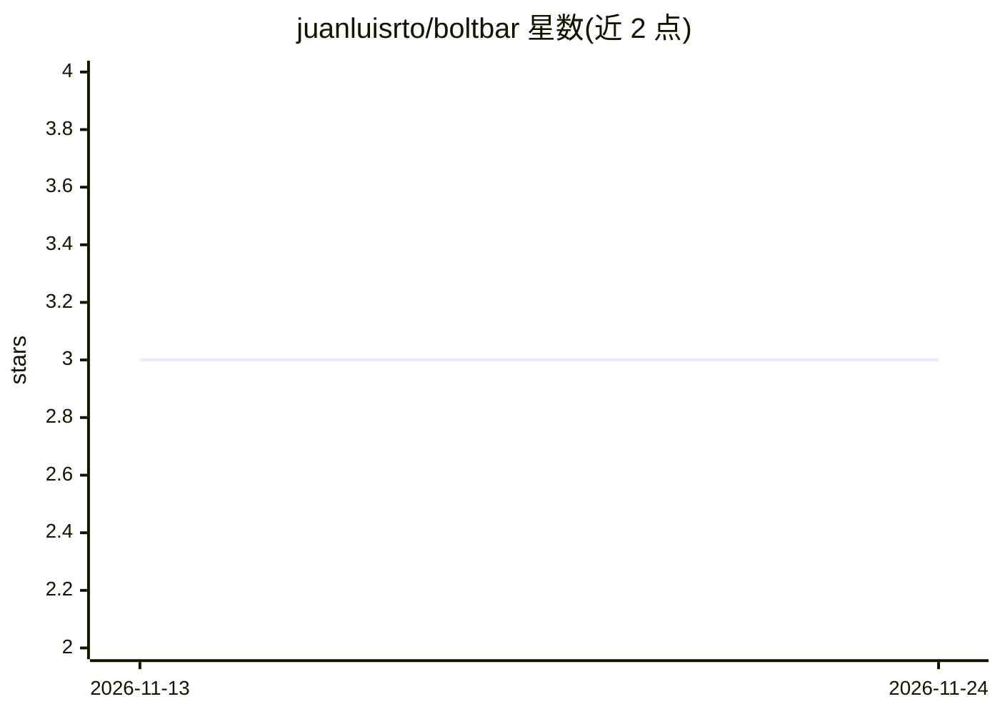

# juanluisrto/boltbar

⭐ 3 · Swift · MIT · 推送 2026-10-27 · [GitHub](https://github.com/juanluisrto/boltbar) · [官网](https://juanluis.me/boltbar) · 个人维护

**macOS 原生 AI 聊天条，⌥Space 快捷调用 GPT 与 Claude**

用 Swift/SwiftUI/AppKit 构建的紧凑聊天栏，⌥Space 唤起、Esc 隐藏，回复流式输出时消息可排队。支持粘贴/拖放图片、PDF 与文本附件，通过 OpenAI Responses 与 Anthropic Messages API（URLSession 直连）或接入已有的 Codex/Claude Code CLI 会话。Agent 模式将请求交给 CLI 在项目文件夹中执行，按四级权限灯（Look/Ask/Edit/Full）控制文件操作。聊天与密钥本地保存（Keychain/应用目录），不做云同步。

## 筛选速览

| 维度 | 判定 | 备注 |
|---|---|---|
| AI 角色 | `ai-native` | 本体是模型或模型工具 |
| 许可风险 | `permissive` | MIT |
| 部署形态 | `None` |  |
| 模型依赖 | locked-api |  |
| 硬件要求 | — | 无带数字的原话,不猜 |
| 安装摩擦 | `low` | 无编译、无系统依赖或容器化 |
| 成熟度 | — | 结构信号不足 |

## 能力要点

- ⌥Space 全局快捷唤起，流式回复期间可继续排队消息
- Agent 模式接入 Claude Code / Codex CLI，四级权限灯控制文件读写
- 图片/PDF/文本附件支持，PDF 需 API 模式
- API 密钥存 macOS Keychain，对话本地存储无云同步

## 适用场景

- 在任意应用中随时快捷键唤起与 GPT/Claude 对话
- 让 AI agent 在指定项目文件夹内按权限级别读写代码
- 脱离浏览器在原生界面管理多会话历史并本地检索

## 场景标签

`聊天机器人` `AI 助手` · 领域:对话与助手

## 证据(README 行号)

> L3: A compact AI chat bar built in Swift, SwiftUI and AppKit. Starting with v0.2.0, the native implementation replaces t
> L7: - **⌥ Space** opens a new conversation; **Esc** hides it. While a reply is streaming, messages are queued, or a repl
> L20: - OpenAI Responses and Anthropic Messages through URLSession; optional existing Codex or Claude Code CLI sessions.

## 星数曲线

2026-11-13 3 → 2026-11-24 3（+0）

---
*卡片 v1 · prompt 1.4 · 生成 2026-11-21 · 置信度 high · 依据 README sha `a57c9043827e` · [字段定义](../../DATASET.md)*
