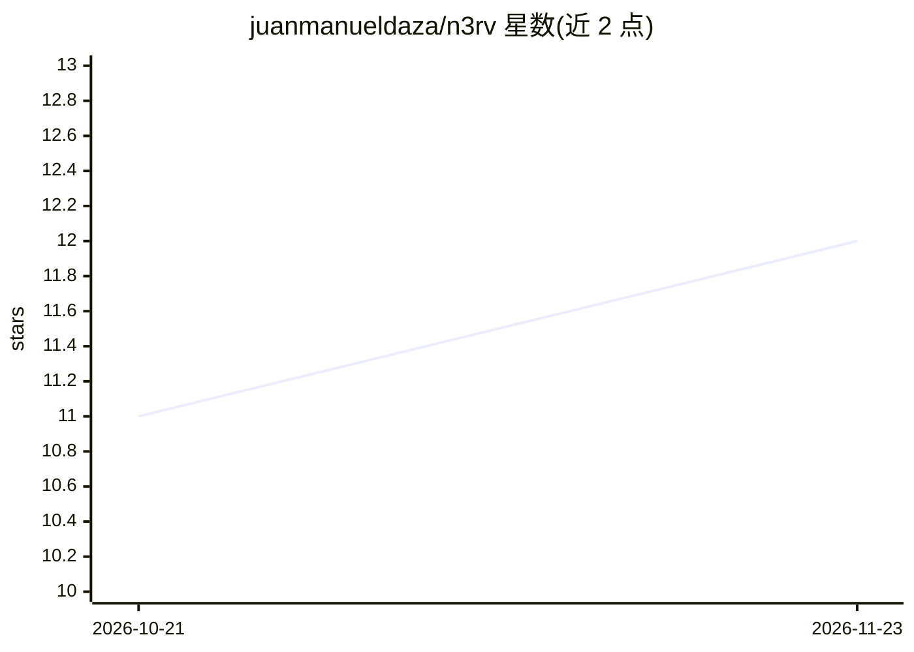

# juanmanueldaza/n3rv

⭐ 12 · Python · Apache-2.0 · 推送 2026-10-13 · [GitHub](https://github.com/juanmanueldaza/n3rv) · [官网](https://n3rv.daza.ar) · 个人维护

**面向 opencode AI agent 的运行时基础设施库**

为 opencode agent 提供运行时库与配置生成：将任意仓库脚手架为 agent 工作区（AGENTS.md、opencode.json、技能、命令、插件），并运行 4 个 MCP 服务器（记忆 12 工具、A2A 任务分发 hub、多语言执行、Python 代码图）。记忆基于 ChromDB+SQLite，支持 BM25 冲突检测与 TTL 清理；守护进程经 systemd 用户单元常驻。面向使用 opencode 的开发者，用于接入/运行/管理 agent。

## 筛选速览

| 维度 | 判定 | 备注 |
|---|---|---|
| AI 角色 | `ai-ecosystem` | LLM/agent 周边工具 |
| 许可风险 | `permissive` | Apache-2.0 |
| 部署形态 | `library` | 以包/库形式分发 |
| 模型依赖 | local-ok | 支持本地模型 |
| 硬件要求 | — | 无带数字的原话,不猜 |
| 安装摩擦 | `low` | 无编译、无系统依赖或容器化 |
| 成熟度 | — | 结构信号不足 |

## 能力要点

- 4 个 MCP 服务器共 31 个工具：记忆、A2A hub、执行、代码图
- ChromaDB 语义记忆 + SQLite 关系存储，BM25 冲突检测
- ModelProvider 抽象支持 qwen/openai/local（Ollama/vLLM 兼容）与回退链
- 8 阶段 SDD 工作流与 Jinja2 模板脚手架生成

## 适用场景

- 为 opencode agent 工作区生成 MCP 配置与技能脚手架
- 跨进程委派 agent 任务并持久化语义记忆
- 对 20+ 语言的代码执行统一的 lint/typecheck/test 工具链

## 场景标签

`Agent 框架` `Agent 记忆` · 领域:Agent 开发

## 证据(README 行号)

> L3: **Invisible engineering infrastructure for opencode agents.**
> L11: n3rv is a **runtime library and config generator** for opencode. It scaffolds any repo (python/node/go/generic) int

## 星数曲线

2026-10-21 11 → 2026-11-23 12（+1）

---
*卡片 v1 · prompt 1.4 · 生成 2026-11-18 · 置信度 high · 依据 README sha `6bbab8aaf458` · [字段定义](../../DATASET.md)*
