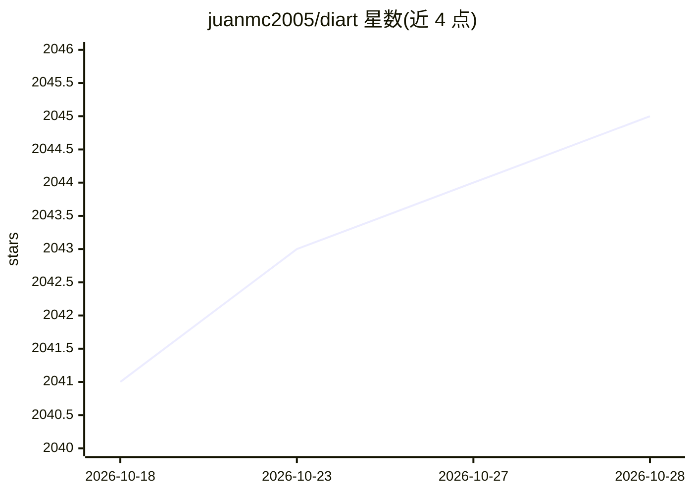

# juanmc2005/diart

⭐ 2,045 · Python · MIT · 推送 2026-06-19 · [GitHub](https://github.com/juanmc2005/diart) · [官网](https://diart.readthedocs.io) · 组织维护

**实时说话人分离 Python 框架：流式识别音频中不同说话人**

Python 框架 diart，核心能力是实时流式说话人分离（speaker diarization）：`SpeakerDiarization` 管线组合分割与说话人嵌入模型，驱动随对话推进逐步精化的增量聚类；另提供语音活动检测预训练管线（转录管线标注 coming soon）。支持 CLI 与 Python API 从音频文件或麦克风流式推理、基于 optuna 的超参调优（含分布式）、可组合构建块（RxPY 流式）、WebSocket 部署与基准评测。默认依赖 pyannote.audio 模型，需在 Hugging Face 接受使用条款并登录。系统需预装 ffmpeg、portaudio、libsndfile。

## 筛选速览

| 维度 | 判定 | 备注 |
|---|---|---|
| AI 角色 | `ai-native` | 本体是模型或模型工具 |
| 许可风险 | `permissive` | MIT |
| 部署形态 | `library` | 以包/库形式分发 |
| 模型依赖 | — | README 未给出锁定关系 |
| 硬件要求 | — | 无带数字的原话,不猜 |
| 安装摩擦 | `medium` | 含编译或系统依赖之一 |
| 成熟度 | — | 结构信号不足 |

## 能力要点

- 分割+嵌入模型驱动的增量聚类实时说话人分离管线
- 支持麦克风/文件流式推理、WebSocket 服务化部署
- 列出 10 个可用的预训练分割/嵌入模型（pyannote、speechbrain、wespeaker、nvidia）
- 基于 optuna 的超参调优（含 MySQL/PostgreSQL 分布式）与 Benchmark 评测

## 适用场景

- 对会议或对话录音做实时说话人分离
- 构建自定义流式音频 AI 管线并通过 WebSocket 服务化
- 在数据集上评测说话人分离延迟与性能并复现论文结果

## 场景标签

`语音识别` · 领域:感知与多模态

## 证据(README 行号)

> L39: Diart is a python framework to build AI-powered real-time audio applications.
> L40: Its key feature is the ability to recognize different speakers in real time with state-of-the-art performance,
> L43: The pipeline `diart.SpeakerDiarization` combines a speaker segmentation and a speaker embedding model

## 星数曲线

2026-10-18 2,041 → 2026-10-28 2,045（+4）

---
*卡片 v1 · prompt 1.4 · 生成 2026-10-21 · 置信度 high · 依据 README sha `d1e9176ddf19` · [字段定义](../../DATASET.md)*
