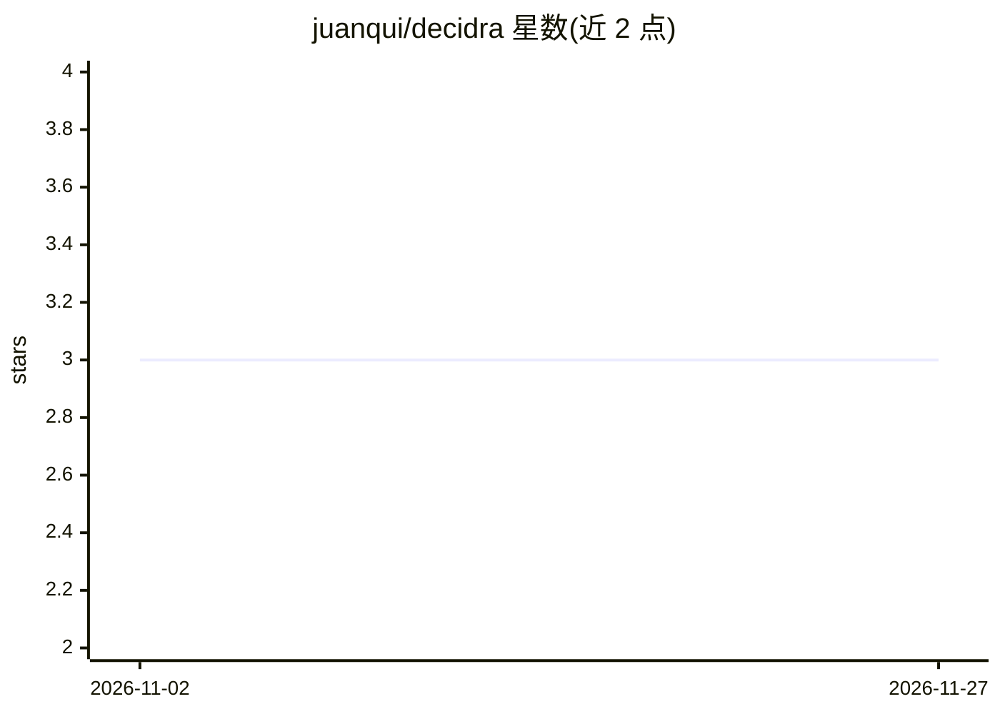

# juanqui/decidra

⭐ 3 · Rust · NOASSERTION · 推送 2026-10-25 · [GitHub](https://github.com/juanqui/decidra) · 个人维护

**面向 vllm-sr/d3-turbo 单一模型的原生 CUDA 推理引擎**

Decidra 是为 vllm-sr/d3-turbo（26.1B Qwen3.5 混合决策模型）专用构建的 CUDA 推理引擎，非通用模型运行器。HTTP 服务器与 CUDA 引擎合于一个 Rust 进程，运行时不含 Python/PyTorch/vLLM。核心机制：利用 prefix_bidir 注意力掩码将提示切分为状态块与问题块，状态编码一次后缓存（K/V、GDN 递归状态、卷积尾），所有问题从缓存分叉，单次 ragged pass 加一次 readout GEMM 即可输出 choice/noul/score 类型决策。提供 Docker 镜像（按 GPU 架构分 tag）、源码构建、compose 文件，暴露 /v1/systemone、/health、/metrics 等 HTTP 端点。README 声称相对 vLLM-SR 基准提速 2.4–5.2×。限制：仅支持列明的 NVIDIA GPU 架构，仅服务单一模型。

## 筛选速览

| 维度 | 判定 | 备注 |
|---|---|---|
| AI 角色 | `ai-ecosystem` | LLM/agent 周边工具 |
| 许可风险 | `none` | NOASSERTION |
| 部署形态 | `self-host` | docker 或自建部署 |
| 模型依赖 | — | README 未给出锁定关系 |
| 硬件要求 | `gpu-24g` | |
| 安装摩擦 | `low` | 无编译、无系统依赖或容器化 |
| 成熟度 | — | 结构信号不足 |

## 能力要点

- 状态一次编码、缓存后服务所有问题的 state-once 推理机制
- 运行时为单一 Rust 进程，无 Python/PyTorch/vLLM 依赖
- 支持 choice/noul/score 类型化问题与图像输入（PNG/JPEG/WebP data URL）
- 按 SM89/SM90/SM120 架构发布 Docker 镜像与 Prometheus 指标

## 适用场景

- 对同一状态文本批量发起最多 64 个决策类问题
- 在自有 NVIDIA GPU 上以容器化方式部署 d3-turbo 模型服务
- 需要类型化决策输出（选项/得分/概率）的推理服务

## 场景标签

`推理引擎` · 领域:训练与推理

## 证据(README 行号)

> L9: Decidra is a purpose-built CUDA inference engine for exactly one model:
> L13: It is not a general model runner. The HTTP server and the CUDA engine are one
> L43: ## Quick start

## 星数曲线

2026-11-02 3 → 2026-11-27 3（+0）

---
*卡片 v1 · prompt 1.4 · 生成 2026-11-21 · 置信度 high · 依据 README sha `96378a680d15` · [字段定义](../../DATASET.md)*
