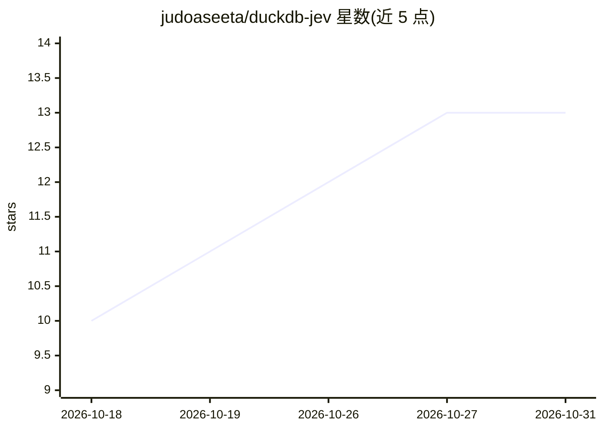

# judoaseeta/duckdb-jev

⭐ 13 · C++ · MIT · 推送 2026-09-21 · [GitHub](https://github.com/judoaseeta/duckdb-jev) · [官网](https://pgjev.com) · 个人维护

**DuckDB 扩展：用自然语言条件对表行做 LLM 判断查询**

jev for DuckDB 是用 C++ 编写的 DuckDB 扩展，把 pg-jev 移植到 DuckDB：提供 jev()/jev_prob() 等 SQL 函数，将整行作为 struct 发给 TypeSafe 的 Jev 模型（返回校准概率而非生成文本），从而用自然语言条件过滤、打分或分类表行。批量 20 行/请求、16 并发、按行内容缓存；无需索引、嵌入或向量列。面向需要在 SQL 内做语义判断的开发者。需从源码编译（CMake/C++17/OpenSSL），行数据会发送到第三方 API。

## 筛选速览

| 维度 | 判定 | 备注 |
|---|---|---|
| AI 角色 | `ai-native` | 本体是模型或模型工具 |
| 许可风险 | `permissive` | MIT |
| 部署形态 | `None` |  |
| 模型依赖 | — | README 未给出锁定关系 |
| 硬件要求 | — | 无带数字的原话,不猜 |
| 安装摩擦 | `low` | 无编译、无系统依赖或容器化 |
| 成熟度 | — | 结构信号不足 |

## 能力要点

- jev()/jev_prob()/jev_choice()/jev_score() 等 SQL 级语义判断函数
- 默认 20 行/请求批量评估、16 并发、按行内容进程级缓存
- 与普通 SQL 谓词组合（AND/joins/LIMIT），便宜谓词先过滤省请求
- jev_max_rows_per_statement 等设置可限制发送行数与字符数

## 适用场景

- 在 SQL 查询里用自然语言条件筛选行（如'客户威胁要离开'）
- 对表行按语义问题打分、分类并返回概率
- 把语义判断与常规算术/日期条件组合在同一 WHERE 中

## 场景标签

`语义搜索` · 领域:知识与检索

## 证据(README 行号)

> L3:  Ask your DuckDB tables questions in plain language.
> L12: Every row is judged by TypeSafe's Jev, a model that returns calibrated
> L13: probabilities instead of generated text. No index, no embeddings, no vector column.

## 星数曲线

2026-10-18 10 → 2026-10-31 13（+3）

---
*卡片 v1 · prompt 1.4 · 生成 2026-10-31 · 置信度 high · 依据 README sha `e09a56c547b9` · [字段定义](../../DATASET.md)*
