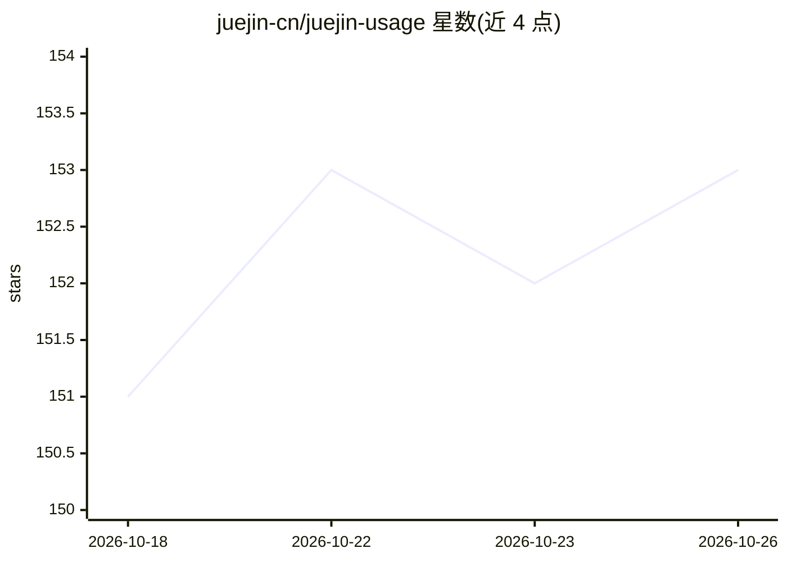

# juejin-cn/juejin-usage

⭐ 153 · TypeScript · MIT · 推送 2026-10-25 · [GitHub](https://github.com/juejin-cn/juejin-usage) · [官网](https://juejin.cn/aiusage/dashboard) · 组织维护 · 中文 README

**追踪 AI 编码工具 Token 用量的桌面/CLI 工具，含云端排行榜**

掘金开源的 AI 编码工具用量追踪工具：首次运行采集本机已产生的用量，面板展示费用、Token、请求数与趋势，登录后可查看订阅剩余额度、多设备合并用量并参与线上排行榜。提供 macOS/Windows 桌面客户端与 Node.js CLI 两种形态，CLI 启动后台服务打开本地面板。本地优先架构，数据默认存于设备，云端同步需主动开启且仅上报脱敏计数。附带可选桌面宠物功能。

## 筛选速览

| 维度 | 判定 | 备注 |
|---|---|---|
| AI 角色 | `ai-ecosystem` | LLM/agent 周边工具 |
| 许可风险 | `permissive` | MIT |
| 部署形态 | `desktop` | 安装包/桌面程序 |
| 模型依赖 | — | README 未给出锁定关系 |
| 硬件要求 | — | 无带数字的原话,不猜 |
| 安装摩擦 | `medium` | 含编译或系统依赖之一 |
| 成熟度 | — | 结构信号不足 |

## 能力要点

- 面板展示费用、Token、请求数与用量趋势，支持订阅剩余额度查看
- macOS/Windows 桌面客户端与跨平台 npm CLI（后台服务+本地面板）
- 本地优先：不收集对话内容、Prompt、API Key，云端同步需主动开启
- 登录掘金后可多设备合并用量并参与 AI 使用排行榜

## 适用场景

- 查看本机各 AI 编码工具的 Token 消耗与费用趋势
- 多设备合并查看自己的 AI 用量并参与排行榜
- 在菜单栏/托盘快速查看订阅剩余额度与今日用量

## 场景标签

`LLM 可观测性` · 领域:评测与运维

## 证据(README 行号)

> L3:  Token 用量明细追踪工具，本地记录、云端同步， 还能看订阅剩余额度，以及线上排行榜看谁用得多。
> L44: 2. 首次运行会采集本机已经产生的 AI 编码工具用量
> L45: 3. 面板展示费用、Token、请求数和用量趋势；已登录且支持的渠道还会显示订阅剩余额度

## 星数曲线

2026-10-18 151 → 2026-10-26 153（+2）

---
*卡片 v1 · prompt 1.4 · 生成 2026-10-22 · 置信度 high · 依据 README sha `f97e1752da78` · [字段定义](../../DATASET.md)*
