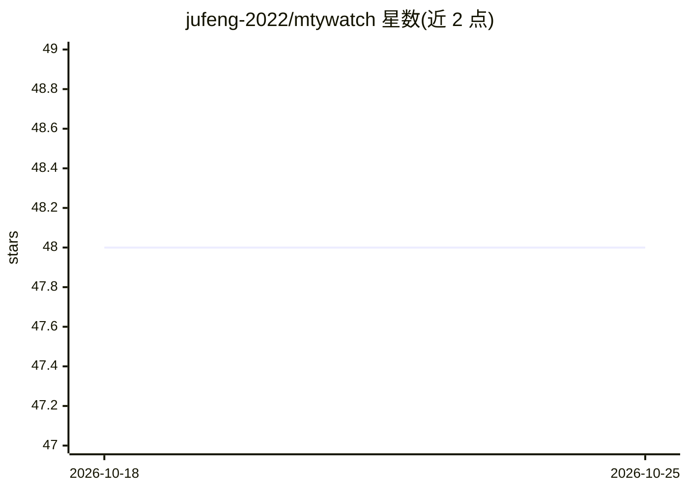

# jufeng-2022/mtywatch

⭐ 48 · 推送 2025-12-23 · [GitHub](https://github.com/jufeng-2022/mtywatch) · [官网](https://mtywatch.com) · 组织维护 · 中文 README

**一句话配置网页内容监控与更新提醒的在线服务**

猫头鹰AI 是一个网页订阅服务：用户输入网页地址并用自然语言描述监控目标（如新闻、招聘、商品上架），系统以 AI 加爬虫自动分析页面（1-2 分钟）并持续监控，通过邮件、微信、短信、webhook 等方式通知。采用积分制，注册赠送积分与监控额度；云服务默认不抓取墙外网站，可人工审核加白，另提供浏览器插件版本供本地使用。

## 筛选速览

| 维度 | 判定 | 备注 |
|---|---|---|
| AI 角色 | `ai-native` | 本体是模型或模型工具 |
| 许可风险 | `none` | — |
| 部署形态 | `None` |  |
| 模型依赖 | — | README 未给出锁定关系 |
| 硬件要求 | — | 无带数字的原话,不猜 |
| 安装摩擦 | `low` | 无编译、无系统依赖或容器化 |
| 成熟度 | — | 结构信号不足 |

## 能力要点

- 自然语言一句话描述监控目标，无需写爬虫代码或 xpath
- AI 自动分析页面（1-2 分钟）后实时监控
- 支持邮件、微信、短信、webhook 等通知方式
- 提供浏览器插件版本，可在本地网络环境使用

## 适用场景

- 不写代码就监控网页上特定新闻或通知的发布
- 商品上架、招聘信息等页面变化的及时提醒
- 将网页变化通过 webhook 接入自己的流程

## 场景标签

`网页抓取` · 领域:效率与自动化

## 证据(README 行号)

> L10: AI+爬虫技术，实现一句话就能自动监控页面内容，实时订阅你关心的内容
> L17: 3、AI自动分析（1-2分钟），实时监控，支持邮件、微信、短信、webhook等通知方式

## 星数曲线

2026-10-18 48 → 2026-10-25 48（+0）

---
*卡片 v1 · prompt 1.4 · 生成 2026-10-25 · 置信度 high · 依据 README sha `199defb15112` · [字段定义](../../DATASET.md)*
