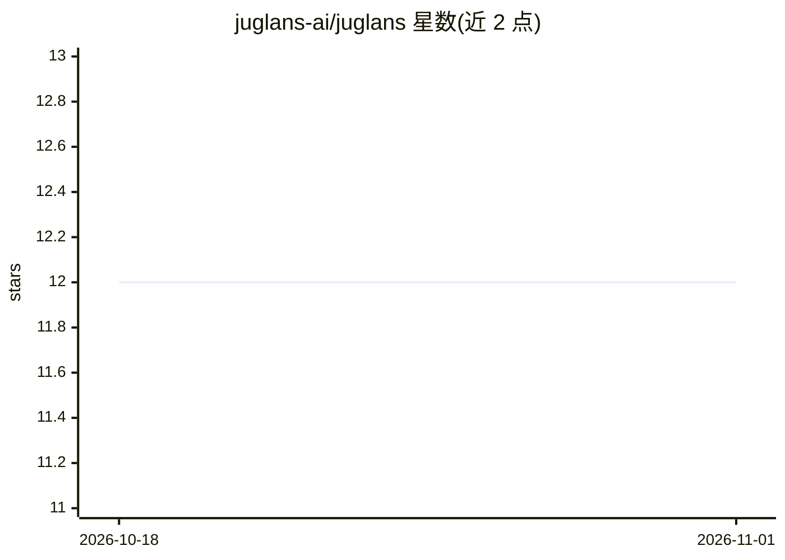

# juglans-ai/juglans

⭐ 12 · Rust · MIT · 推送 2026-05-03 · [GitHub](https://github.com/juglans-ai/juglans) · [官网](https://juglans.dev) · 组织维护

**Rust 编写的 AI agent 工作流 DSL：编译器、运行时与 CLI**

面向开发者的声明式 DSL：工作流文件即类型化 DAG，由编译器解析、校验并执行，无需 DAG-builder 样板代码。支持条件边、switch 路由、循环、错误处理与函数定义，内置 100+ 表达式函数；原生接入 OpenAI、Anthropic、DeepSeek、Gemini、Qwen 等 LLM 提供商，支持 MCP 工具源、Python 生态桥接，可经 serve() 变为 HTTP 服务或经 Telegram/Discord/飞书/微信适配器变为聊天机器人。提供预编译二进制安装脚本，也可从源码 cargo 安装（需 Rust 1.80+）。

## 筛选速览

| 维度 | 判定 | 备注 |
|---|---|---|
| AI 角色 | `ai-ecosystem` | LLM/agent 周边工具 |
| 许可风险 | `permissive` | MIT |
| 部署形态 | `library` | 以包/库形式分发 |
| 模型依赖 | locked-api |  |
| 硬件要求 | — | 无带数字的原话,不猜 |
| 安装摩擦 | `low` | 无编译、无系统依赖或容器化 |
| 成熟度 | — | 结构信号不足 |

## 能力要点

- 工作流文件即 DAG，编译器负责解析、校验与执行
- 原生 LLM 提供商：OpenAI/Anthropic/DeepSeek/Gemini/Qwen/xAI/火山方舟
- MCP 集成与 Python 生态桥接（pandas、sklearn 可直接调用）
- serve() 嵌入 HTTP 后端，Bot 适配器一键将工作流变为聊天机器人

## 适用场景

- 用声明式 DAG 编排多 agent 分支与汇聚的工作流
- 把一个工作流发布为 HTTP 接口或 Telegram/Discord 聊天机器人
- 通过 MCP 接入工具源，在 DSL 中复用 LLM 与 Python 库

## 场景标签

`多智能体` `工作流自动化` `Agent 框架` · 领域:Agent 开发

## 证据(README 行号)

> L6:  A Rust-native DSL for AI agent workflows — where the DAG you draw is the DAG you run.
> L44: - **Native LLM providers** — OpenAI, Anthropic, DeepSeek, Google Gemini, Qwen, xAI, ByteDance Ark (no broker, no pr

## 星数曲线

2026-10-18 12 → 2026-11-01 12（+0）

---
*卡片 v1 · prompt 1.4 · 生成 2026-11-01 · 置信度 high · 依据 README sha `4323ccc638ca` · [字段定义](../../DATASET.md)*
