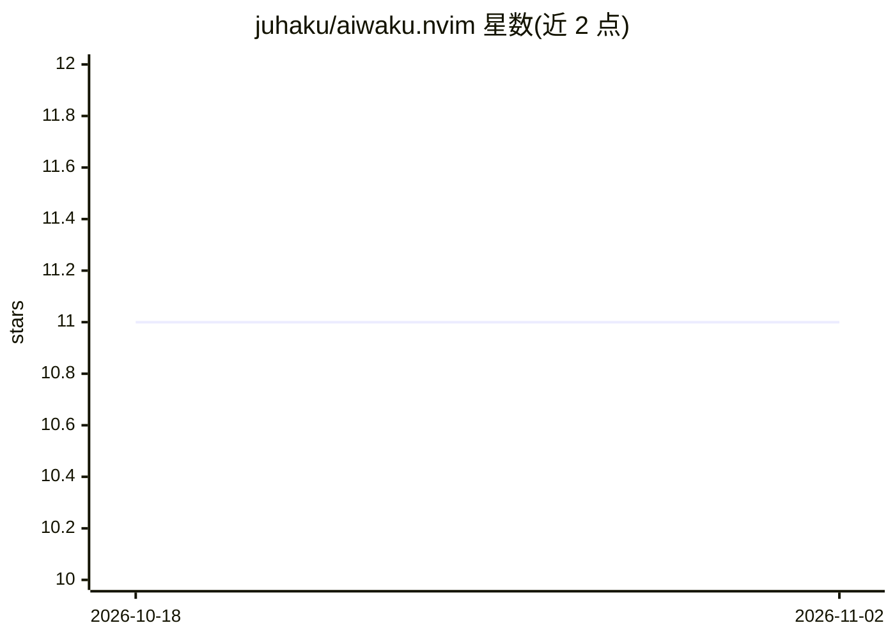

# juhaku/aiwaku.nvim

⭐ 11 · Lua · MIT · 推送 2026-06-09 · [GitHub](https://github.com/juhaku/aiwaku.nvim) · 个人维护

**把任意 CLI AI 工具接入 Neovim 的持久侧边栏插件**

Neovim 插件，将 copilot、claude、opencode、aider 等任意命令行 AI 助手运行在 tmux 会话中并挂载为编辑器侧边栏分栏；会话在窗口切换、Neovim 重启、工作区切换后保留。支持多会话创建/切换/重命名、发送选区/整缓冲区/诊断信息给 AI，并通过 null-ls 暴露 LSP code action（解释代码、修复诊断等）。要求 Neovim ≥0.10 与 tmux ≥3.0（tmux 缺失时会话功能不可用）。以 lazy.nvim 等 Neovim 插件管理器安装。

## 筛选速览

| 维度 | 判定 | 备注 |
|---|---|---|
| AI 角色 | `ai-ecosystem` | LLM/agent 周边工具 |
| 许可风险 | `permissive` | MIT |
| 部署形态 | `None` |  |
| 模型依赖 | — | README 未给出锁定关系 |
| 硬件要求 | — | 无带数字的原话,不猜 |
| 安装摩擦 | `low` | 无编译、无系统依赖或容器化 |
| 成熟度 | — | 结构信号不足 |

## 能力要点

- 工具无关：可配置任意 CLI AI 命令，支持多工具切换
- 基于 tmux 的持久会话，跨重启保留上下文
- 发送选区/整文件/诊断到 AI 的快捷键与 LSP code action
- 异步 tmux 操作，编辑器保持响应

## 适用场景

- 在 Neovim 侧边栏中持续使用自己偏好的 CLI AI 助手
- 把选中代码或诊断信息直接发给 AI 处理
- 在编辑器重启后继续之前的 AI 对话上下文

## 场景标签

 · 领域:开发者工具/编辑器插件

## 证据(README 行号)

> L3: A Neovim plugin that brings any CLI AI tool into your editor as a persistent sidebar panel.
> L7: aiwaku does not lock you into a specific AI tool. You point it at any command-line AI assistant —
> L8: `copilot`, `claude`, `opencode`, `aider`, or anything else — and it runs it in a tmux session

## 星数曲线

2026-10-18 11 → 2026-11-02 11（+0）

---
*卡片 v1 · prompt 1.4 · 生成 2026-11-02 · 置信度 high · 依据 README sha `c7e3f39bdfde` · [字段定义](../../DATASET.md)*
