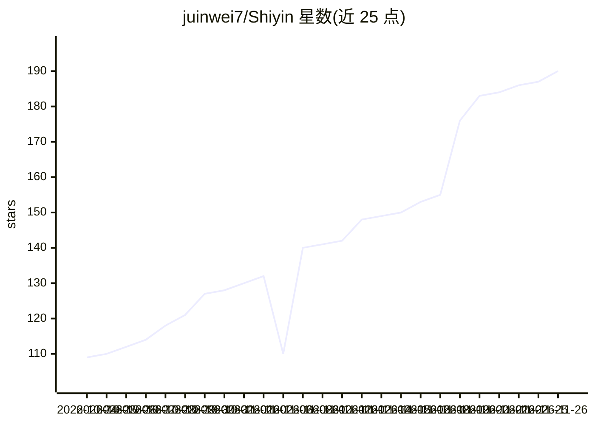

# juinwei7/Shiyin

⭐ 190 · C# · MIT · 推送 2026-11-25 · [GitHub](https://github.com/juinwei7/Shiyin) · [官网](https://shiyin.weibuilds.com) · 个人维护 · 中文 README

**Mac 上的本地会议记录应用：录音、本地转写、AI 生成带时间戳的笔记**

面向 macOS 用户的会议笔记应用：录制线下或线上会议（Zoom/Meet/Teams 声音经系统音频采集，无需 bot），实时显示转写草稿，会后在本机完成转写与说话人识别，再由用户自配的 Claude Code、Codex CLI 或各家 API 生成含摘要、决策、行动项的笔记，每条内容带可点击回跳录音的时间戳。录音与转写全部本地进行，不上传录音；摘要需联网及用户已有账号或 API key。要求 Apple Silicon 与 macOS 26，模型约 1.7 GB 首次使用时下载。

## 筛选速览

| 维度 | 判定 | 备注 |
|---|---|---|
| AI 角色 | `ai-native` | 本体是模型或模型工具 |
| 许可风险 | `permissive` | MIT |
| 部署形态 | `desktop` | 安装包/桌面程序 |
| 模型依赖 | local-ok | 支持本地模型 |
| 硬件要求 | — | 无带数字的原话,不猜 |
| 安装摩擦 | `high` | 编译与系统依赖俱全 |
| 成熟度 | — | 结构信号不足 |

## 能力要点

- whisper.cpp + Breeze ASR 25 本地转写，可切换 llama.cpp + Qwen3-ASR 或 macOS 内置识别
- 说话人识别与声纹记忆，声纹仅保存在本机
- 摘要器可选 Claude Code、Codex CLI、Anthropic/OpenAI/Gemini API 或 OpenAI 兼容 API（含本机 Ollama/LM Studio）
- 提供 MCP 只读接口，供 AI 工具检索会议记录

## 适用场景

- 线上会议不开 bot 也能拿到双方发言的转写与纪要
- 会议内容敏感、希望录音不出本机的团队
- 中英日多语言会议的转写与纪要整理
- 会后用自然语言向会议记录提问并回听原话

## 场景标签

`语音识别` `文档问答` · 领域:知识与检索

## 证据(README 行号)

> L7: A meeting-notes app for macOS. Record a meeting (in person or online) and watch a live transcript as it happens. Aft
> L38: - **Local transcription**: whisper.cpp + Breeze ASR 25 (MediaTek), with your glossary as the prompt. In Settings yo
> L51:  - Summarizers: Claude Code, Codex CLI, Anthropic API, OpenAI API, Gemini API, an OpenAI-compatible API (Groq, Open

## 星数曲线

2026-10-24 109 → 2026-11-26 190（+81）

---
*卡片 v1 · prompt 1.4 · 生成 2026-11-26 · 置信度 high · 依据 README sha `c55eb4e239f0` · [字段定义](../../DATASET.md)*
