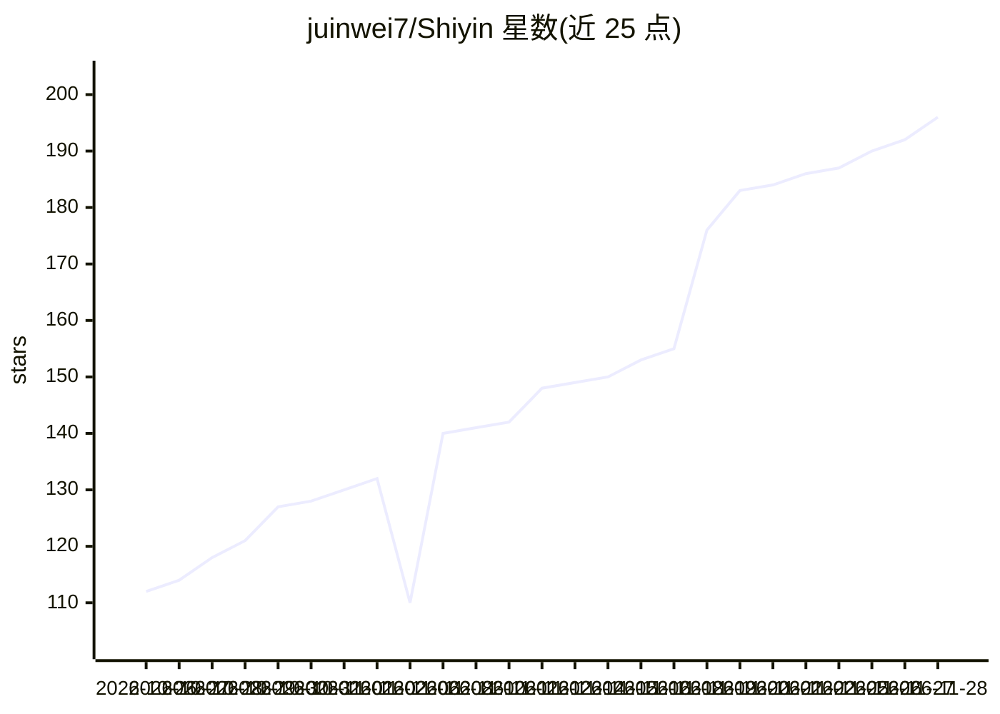

# juinwei7/Shiyin

⭐ 196 · C# · MIT · 推送 2026-11-27 · [GitHub](https://github.com/juinwei7/Shiyin) · [官网](https://shiyin.weibuilds.com) · 个人维护 · 中文 README

**macOS 会议记录应用：本地转录录音并生成带时间戳的会议纪要**

面向 macOS 用户的会议记录应用：录制线上或线下会议并显示实时转写，结束后在本机用 whisper.cpp/Breeze ASR 等模型转录、识别说话人，再由 Claude Code、Codex CLI 或各家 API/OpenAI 兼容接口生成含摘要、决定、行动项的纪要，每条内容带可点击回放的时间戳。录音不上传；支持导入音视频与字幕、Markdown/PDF/Word 导出、MCP 只读接口、声纹记忆与术语表校正。要求 Apple Silicon 与 macOS 26，模型约 1.7 GB 首次下载。

## 筛选速览

| 维度 | 判定 | 备注 |
|---|---|---|
| AI 角色 | `ai-native` | 本体是模型或模型工具 |
| 许可风险 | `permissive` | MIT |
| 部署形态 | `desktop` | 安装包/桌面程序 |
| 模型依赖 | local-ok | 支持本地模型 |
| 硬件要求 | — | 无带数字的原话,不猜 |
| 安装摩擦 | `high` | 编译与系统依赖俱全 |
| 成熟度 | — | 结构信号不足 |

## 能力要点

- 录音、转录与说话人识别全部本地运行，录音不上传
- whisper.cpp + Breeze ASR 25 本地转录，可切换 llama.cpp + Qwen3-ASR 或 macOS 内置识别
- 纪要生成支持 Claude Code、Codex CLI、Anthropic/OpenAI/Gemini API 及 OpenAI 兼容接口（含本地 Ollama/LM Studio）
- 支持 MCP：让 Claude Code/Claude Desktop 等工具跨会议只读检索

## 适用场景

- 无机器人录制 Zoom/Meet/Teams 会议并本地转写
- 生成带时间戳、可点击回放原文的会议纪要
- 多语言会议（中/英/日）的说话人分离与术语校正

## 场景标签

`语音识别` · 领域:感知与多模态

## 证据(README 行号)

> L7: A meeting-notes app for macOS. Record a meeting (in person or online) and watch a live transcript as it happens. Aft
> L38: - **Local transcription**: whisper.cpp + Breeze ASR 25 (MediaTek), with your glossary as the prompt. In Settings yo
> L51:  - Summarizers: Claude Code, Codex CLI, Anthropic API, OpenAI API, Gemini API, an OpenAI-compatible API (Groq, Open

## 星数曲线

2026-10-26 112 → 2026-11-28 196（+84）

---
*卡片 v1 · prompt 1.4 · 生成 2026-11-28 · 置信度 high · 依据 README sha `f6024a2b92ba` · [字段定义](../../DATASET.md)*
