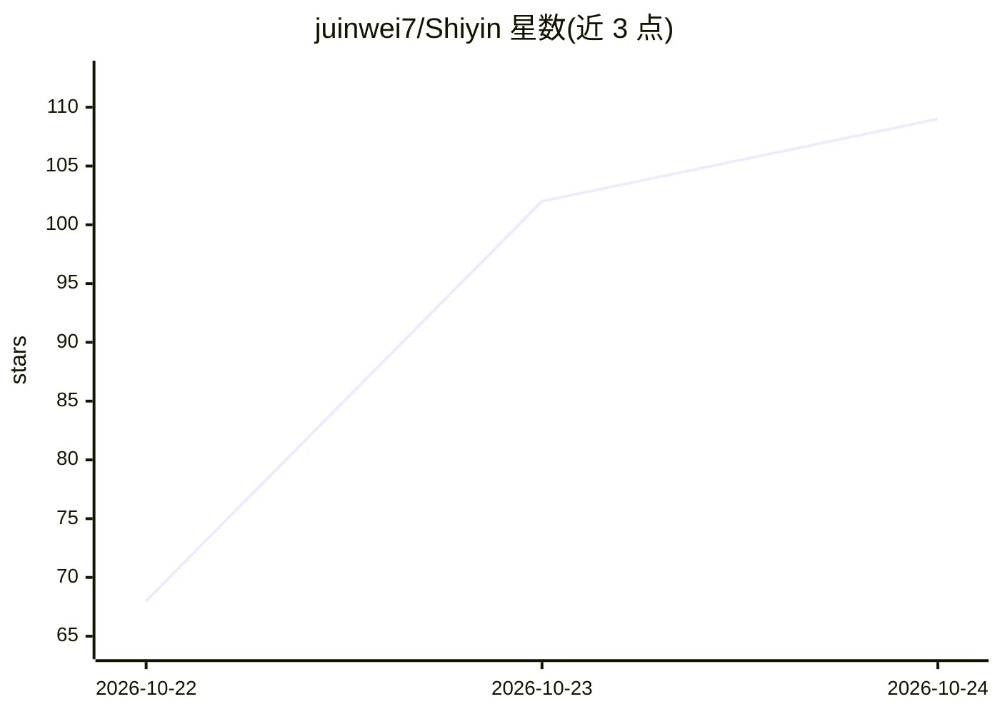

# juinwei7/Shiyin

⭐ 109 · C# · MIT · 推送 2026-10-22 · [GitHub](https://github.com/juinwei7/Shiyin) · [官网](https://shiyin.weibuilds.com) · 个人维护 · 中文 README

**macOS/Windows 本地会议转录与笔记应用（拾音）**

面向终端用户的会议记录应用：录制线下或 Zoom/Meet/Teams 会议（无机器人），在设备上用 whisper.cpp + Breeze ASR 25 转录、识别说话人，并调用 Claude Code、Codex CLI、Anthropic/OpenAI/Gemini API 或 OpenAI 兼容接口（Groq、OpenRouter、Ollama、LM Studio）生成带时间戳的会议纪要。录音、转录与说话人识别均在本地完成，不上传录音。界面为英文与繁体中文。要求 Apple Silicon + macOS 26 或 Windows 11（.NET 10 重写版），应用未经 Apple 公证。

## 筛选速览

| 维度 | 判定 | 备注 |
|---|---|---|
| AI 角色 | `ai-native` | 本体是模型或模型工具 |
| 许可风险 | `permissive` | MIT |
| 部署形态 | `desktop` | 安装包/桌面程序 |
| 模型依赖 | local-ok | 支持本地模型 |
| 硬件要求 | — | 无带数字的原话,不猜 |
| 安装摩擦 | `medium` | 含编译或系统依赖之一 |
| 成熟度 | — | 结构信号不足 |

## 能力要点

- 本地转录（whisper.cpp + Breeze ASR 25）与说话人识别，录音不上传
- 时间戳笔记：纪要条目可点击跳回录音原声
- 声纹记忆：命名说话人后自动在后续会议填入名字
- 多种摘要后端：Claude Code/Codex CLI/各家 API/Ollama 等本地模型

## 适用场景

- 开会时录音并实时看转写，会后生成带时间戳的纪要
- 在会议上直接提问并定位到原话出处
- 导出 Markdown/PDF/Word 纪要与字幕，或打包 .shiyin 分享

## 场景标签

`语音识别` `文档问答` · 领域:知识与检索

## 证据(README 行号)

> L7: A meeting-notes app for macOS. Record a meeting (in person or online) and watch a live transcript as it happens. Aft
> L9: - Recording, transcription and speaker identification all run locally; recordings are never uploaded
> L38: - **Local transcription**: whisper.cpp + Breeze ASR 25, with your glossary as the prompt; Japanese meetings use Whi

## 星数曲线

2026-10-22 68 → 2026-10-24 109（+41）

---
*卡片 v1 · prompt 1.4 · 生成 2026-10-23 · 置信度 high · 依据 README sha `7a26c546c11b` · [字段定义](../../DATASET.md)*
