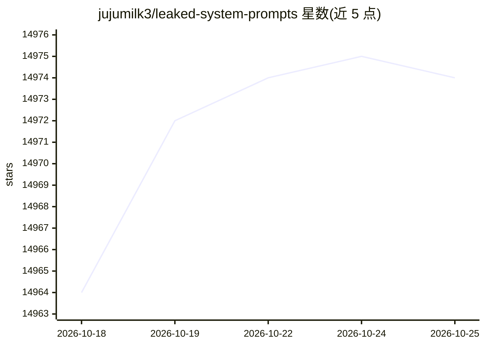

# jujumilk3/leaked-system-prompts

⭐ 14,974 · 推送 2026-09-23 · [GitHub](https://github.com/jujumilk3/leaked-system-prompts) · 个人维护

**收录主流 LLM 服务泄露系统提示词的文档集合**

以文档形式收集被泄露的、来自广泛使用的基于 LLM 的服务的系统提示词。收录流程要求提交的 PR 与现有文档格式一致，并附可验证来源或可复现的提示词；不便走 PR 流程时可在 Issues 区贴链接，由维护者核实后合并。README 说明该仓库被多篇论文引用，并要求提交者不包含敏感商业源代码，以避免 DMCA 下架风险。除收录与提交规范外，README 未描述其他工具或功能。

## 筛选速览

| 维度 | 判定 | 备注 |
|---|---|---|
| AI 角色 | `ai-knowledge` | 知识聚合/清单类 |
| 许可风险 | `none` | — |
| 部署形态 | `None` |  |
| 模型依赖 | — | README 未给出锁定关系 |
| 硬件要求 | — | 无带数字的原话,不猜 |
| 安装摩擦 | `low` | 无编译、无系统依赖或容器化 |
| 成熟度 | — | 结构信号不足 |

## 动量与使用信号

- 维护:`active` — 距上次 push 25.2 天,年发版 0,45 位贡献者
- 涨星:近 1 天 **+0**(自 20261016 起算)

## 能力要点

- 收集来自广泛使用的 LLM 服务的泄露系统提示词
- 收录需附可验证来源或可复现提示词
- 通过 Issues 贴链接的替代投稿通道
- 声明被多篇论文引用并规定 DMCA 风险规避规范

## 适用场景

- 查阅主流 LLM 服务使用的系统提示词原文
- 投稿或补充带可验证来源的泄露提示词
- 为论文引用提供提示词样本来源

## 场景标签

`精选清单` · 领域:学习与行业

## 证据(README 行号)

> L5: This repository is a collection of leaked system prompts from widely used LLM based services.
> L7: 1. If you would like to submit a PR, please match the format of other documents. You must include sources that I can

## 星数曲线

2026-10-18 14,964 → 2026-10-25 14,974（+10）

---
*卡片 v1 · prompt 1.4 · 生成 2026-10-18 · 置信度 high · 依据 README sha `3d0b10862d98` · [字段定义](../../DATASET.md)*
