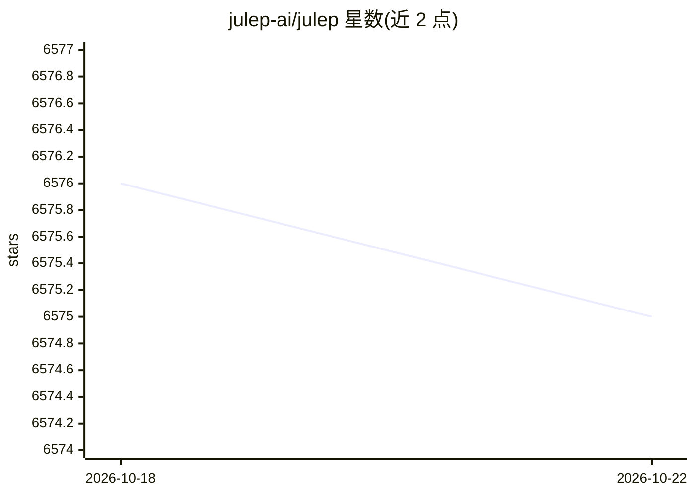

# julep-ai/julep

⭐ 6,575 · Python · Apache-2.0 · 推送 2026-08-06 · [GitHub](https://github.com/julep-ai/julep) · [官网](https://docs.julep.ai) · 组织维护

**面向开发者的持久化可组合 AI agent 工作流框架**

Julep 3 将 AI agent 构建为可组合、可持久化的数据流：`@flow` 定义即构建，将工具、reasoner、分支、fan-out、重试、超时编译为冻结的 IR；流程可崩溃恢复、安全重试并逐步解释，拒绝未授权工具调用。提供 CLI 跨 agent 图发现/选择/部署，可选 Temporal 或 DBOS 持久执行层、MCP 支持、多 provider LLM 调用与 OpenTelemetry/Langfuse 可观测导出。当前为 3.0 release candidate，需 `--pre` 安装；v1 无迁移路径，属不同产品。Apache-2.0 许可。

## 筛选速览

| 维度 | 判定 | 备注 |
|---|---|---|
| AI 角色 | `ai-ecosystem` | LLM/agent 周边工具 |
| 许可风险 | `permissive` | Apache-2.0 |
| 部署形态 | `library` | 以包/库形式分发 |
| 模型依赖 | — | README 未给出锁定关系 |
| 硬件要求 | — | 无带数字的原话,不猜 |
| 安装摩擦 | `low` | 无编译、无系统依赖或容器化 |
| 成熟度 | `idea` | |

## 能力要点

- `@flow` 定义即构建：Python 代码编译为冻结 wire-format IR
- Temporal / DBOS 双可选持久执行后端，流程可崩溃恢复
- CLI 提供 agent 模块发现、选择语法、跨 agent DAG 与发布管理
- 可选 extras 覆盖 MCP、多 provider LLM、OpenTelemetry/Langfuse、wasm 沙箱

## 适用场景

- 构建需要崩溃恢复与安全重试的持久化 agent 工作流
- 通过 CLI 管理与部署一组 agent 及其跨 agent 依赖图
- 以 MCP 快照与工具白名单控制 agent 可调用的外部工具

## 场景标签

`Agent 框架` · 领域:Agent 开发

## 证据(README 行号)

> L3: Julep — durable, composable AI agents. Flows that crash and resume, retry safely, and explain every step.
> L5: Julep builds agents as **composable, durable dataflows** instead of ad-hoc loops: flows can crash and resume, retry 
> L22: from julep import Reasoner, deploy, flow, pure, think, tool

## 星数曲线

2026-10-18 6,576 → 2026-10-22 6,575（-1）

---
*卡片 v1 · prompt 1.4 · 生成 2026-10-20 · 置信度 high · 依据 README sha `767fdb8cb0ce` · [字段定义](../../DATASET.md)*
