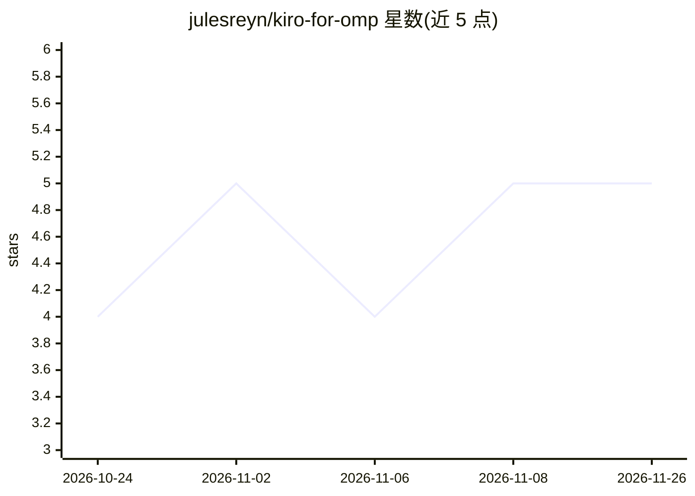

# julesreyn/kiro-for-omp

⭐ 5 · TypeScript · MIT · 推送 2026-10-24 · [GitHub](https://github.com/julesreyn/kiro-for-omp) · 个人维护

**让 OMP 复用 Kiro 账户登录调用 Claude/GPT/Kimi 等模型的扩展**

一个 OMP 扩展，把用户 Kiro 账户中的模型目录接入 OMP 使用。复用已有 kiro-cli 登录（或 API key、refresh token、AWS Builder ID、组织 IAM Identity Center）完成认证，无需额外配置；模型列表来自账户的实时 Kiro 目录，支持 --thinking 档位、并发上限配置、TTFT 与 tokens/s 统计、AWS Event Stream 流式与重试。仅支持 macOS 和 Linux，无依赖，非官方项目，基于 rabesss/omp-kiro-provider。

## 筛选速览

| 维度 | 判定 | 备注 |
|---|---|---|
| AI 角色 | `ai-ecosystem` | LLM/agent 周边工具 |
| 许可风险 | `permissive` | MIT |
| 部署形态 | `None` |  |
| 模型依赖 | — | README 未给出锁定关系 |
| 硬件要求 | — | 无带数字的原话,不猜 |
| 安装摩擦 | `low` | 无编译、无系统依赖或容器化 |
| 成熟度 | — | 结构信号不足 |

## 能力要点

- 复用 kiro-cli 登录，支持 5 种认证方式（含 API key 与组织 SSO）
- 模型列表为账户实时 Kiro 目录，新模型无需更新扩展
- 记录 TTFT 与 tokens/s 供 OMP 状态栏与 omp stats 使用
- AWS Event Stream 帧校验，输出前自动重试容量/服务器错误

## 适用场景

- 在 OMP 中直接使用 Kiro 订阅里的模型额度
- 用 kiro-cli 已有登录免配置接入 OMP
- 通过 /usage 查看剩余 Kiro 额度并按模型选择推理档位

## 场景标签

`模型网关` · 领域:Agent 开发

## 证据(README 行号)

> L4: OMP.
> L6: If `kiro-cli` is already signed in, there is nothing to configure: the extension reuses that login
> L10: > Unofficial. Not affiliated with Kiro, Amazon, AWS or OMP.

## 星数曲线

2026-10-24 4 → 2026-11-26 5（+1）

---
*卡片 v1 · prompt 1.4 · 生成 2026-11-21 · 置信度 high · 依据 README sha `9b6f8baa949d` · [字段定义](../../DATASET.md)*
