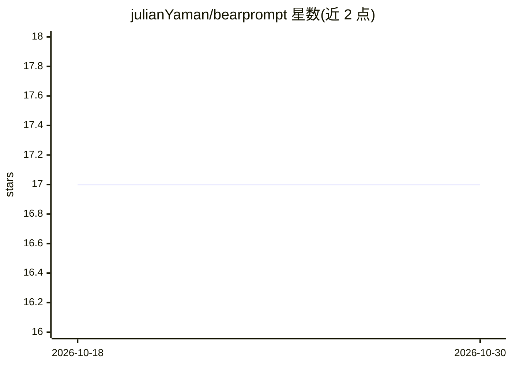

# julianYaman/bearprompt

⭐ 17 · Svelte · MIT · 推送 2026-10-21 · [GitHub](https://github.com/julianYaman/bearprompt) · [官网](https://bearprompt.com) · 个人维护

**私有 AI 提示词库：本地存储、加密分享与公共提示词浏览**

基于 SvelteKit 的提示词管理 Web 应用：私人库以 IndexedDB 存储在浏览器本地，无需注册；支持文件夹、搜索、标签组织，以及端到端加密的分享链接（机制与 Excalidraw 相同）。公共部分（提示词、agent 集合、作者页）由 Supabase 提供，分享防滥用使用 Cloudflare Turnstile。面向在多个 AI 工具间复用提示词的个人用户，可自托管，提供 Docker 部署；公共库与发布功能依赖 Supabase 配置。

## 筛选速览

| 维度 | 判定 | 备注 |
|---|---|---|
| AI 角色 | `ai-knowledge` | 知识聚合/清单类 |
| 许可风险 | `permissive` | MIT |
| 部署形态 | `self-host` | docker 或自建部署 |
| 模型依赖 | — | README 未给出锁定关系 |
| 硬件要求 | — | 无带数字的原话,不猜 |
| 安装摩擦 | `low` | 无编译、无系统依赖或容器化 |
| 成熟度 | — | 结构信号不足 |

## 能力要点

- 私人库本地存储（IndexedDB），无需注册
- 端到端加密分享链接 + Turnstile 防滥用
- 公共提示词与 agent 集合浏览（Supabase 后端）
- 提供 Docker 部署与自托管说明

## 适用场景

- 集中管理我在各 AI 工具中常用的提示词
- 通过加密链接把提示词分享给他人
- 浏览公共提示词库寻找可复用的提示词

## 场景标签

`提示工程` · 领域:Agent 开发

## 证据(README 行号)

> L3:  Your private prompt library, with curated public prompts and agent collections.
> L13: - **Public prompt library**: Browse curated public prompts, featured categories, and highlighted authors.
> L21: - **Your private library** lives in the browser and is stored locally using IndexedDB.

## 星数曲线

2026-10-18 17 → 2026-10-30 17（+0）

---
*卡片 v1 · prompt 1.4 · 生成 2026-10-29 · 置信度 mid · 依据 README sha `8043435f7b56` · [字段定义](../../DATASET.md)*
