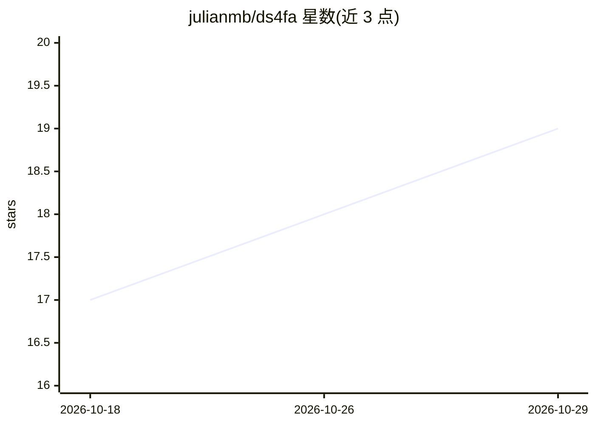

# julianmb/ds4fa

⭐ 19 · C · MIT · 推送 2026-08-28 · [GitHub](https://github.com/julianmb/ds4fa) · 个人维护

**在 AMD Strix Halo 上本地推理 DeepSeek V4 Flash 的引擎 fork**

antirez/ds4 的 gfx1151（Strix Halo）优化分支：为 AMD APU 添加 ROCmFPX 低比特块量化格式与 HIP 内核、SSD 专家流式分配修复、DSpark 投机解码（草稿+一次验证 4 位置）与索引稀疏 prefill，在 Ryzen AI MAX+ 395 上以 128 GB 统一内存运行 284B MoE 模型，报告 32 tok/s 解码与约 250 tok/s prefill。提供 ROCmFPX 高吞吐与原生 GGUF 量化两条路线，含交互 CLI 与 OpenAI 兼容服务器。需从源码编译并安装 ROCm 7.2.x 工具链，仅面向该特定硬件。

## 筛选速览

| 维度 | 判定 | 备注 |
|---|---|---|
| AI 角色 | `ai-ecosystem` | LLM/agent 周边工具 |
| 许可风险 | `permissive` | MIT |
| 部署形态 | `None` |  |
| 模型依赖 | locked-api |  |
| 硬件要求 | — | 无带数字的原话,不猜 |
| 安装摩擦 | `medium` | 含编译或系统依赖之一 |
| 成熟度 | — | 结构信号不足 |

## 能力要点

- ROCmFP2/3/4 混合精度量化使 284B 模型装入 102.3 GB 文件
- DSpark 投机解码：3 层草稿模型 + 单次融合 HIP 图验证 4 位置
- SSD 专家流式 slab 分配器按各层最大尺寸修复 43 层全走快路径
- 提供 OpenAI 兼容服务器与交互 CLI

## 适用场景

- 在 Strix Halo mini-PC 上离线运行 284B DeepSeek V4 Flash
- 以 OpenAI 兼容 API 自托管本地推理服务
- 在 RDNA3.5 APU 上做低比特量化推理实验

## 场景标签

`推理引擎` `模型量化` · 领域:训练与推理

## 证据(README 行号)

> L15:  Up to 32 tok/s decode — a tuned gfx1151 fork of antirez/ds4 with ROCmFPX tooling, SSD expert streaming, and native
> L27: Run a **284B-parameter** model at **up to 32 tok/s** on a single AMD APU — no cloud, no discrete GPU, no per-token 

## 星数曲线

2026-10-18 17 → 2026-10-29 19（+2）

---
*卡片 v1 · prompt 1.4 · 生成 2026-10-28 · 置信度 high · 依据 README sha `8a9518606094` · [字段定义](../../DATASET.md)*
