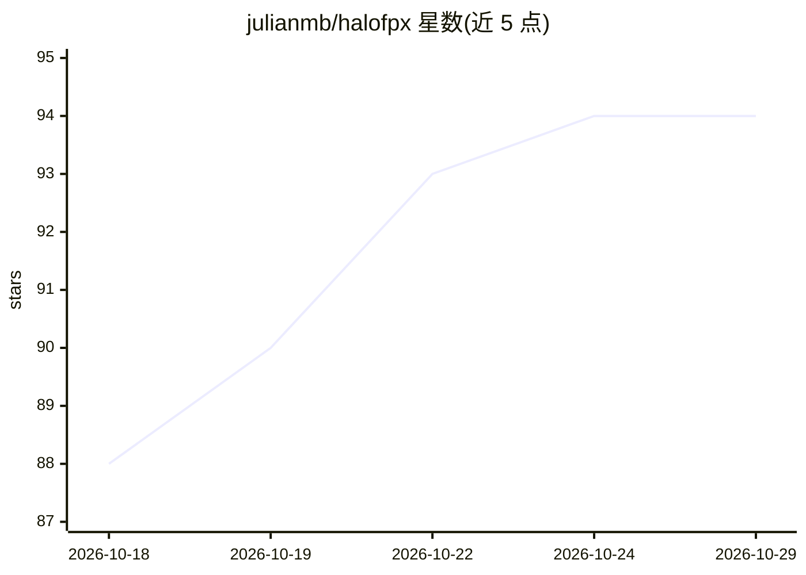

# julianmb/halofpx

⭐ 94 · Python · NOASSERTION · 推送 2026-09-24 · [GitHub](https://github.com/julianmb/halofpx) · [官网](https://huggingface.co/julianmb/Qwen-3.8-27B-ROCmFP4-FAST-GGUF) · 个人维护

**面向 AMD Strix Halo/Radeon GPU 的本地模型服务器与模型库**

单端口（8010）模型服务器，提供 OpenAI 兼容 API 与 Ollama 兼容 API，附 CLI（run/chat/serve/list/load）与模型库：从 Hugging Face 下载预量化模型并按每模型的 benchmark 配置（量化预设、KV cache 类型、后端偏好、MTP 开关）自动加载。面向 AMD Strix Halo（gfx1151）与 Radeon GPU 用户，采用 Vulkan（Mesa RADV Wave64）与 ROCm 双后端、自定义 ROCmFP4 量化格式，支持动态模型热切换、多模态 mmproj 自动加载与 Lemonade 缓存双向共享。提供 Docker Compose 部署（可搭配 Open WebUI）及基准测试脚本。

## 筛选速览

| 维度 | 判定 | 备注 |
|---|---|---|
| AI 角色 | `ai-ecosystem` | LLM/agent 周边工具 |
| 许可风险 | `none` | NOASSERTION |
| 部署形态 | `self-host` | docker 或自建部署 |
| 模型依赖 | local-ok | 支持本地模型 |
| 硬件要求 | — | 无带数字的原话,不猜 |
| 安装摩擦 | `low` | 无编译、无系统依赖或容器化 |
| 成熟度 | — | 结构信号不足 |

## 能力要点

- OpenAI 与 Ollama 双兼容 API，单端口提供 chat/pull/load 等管理端点
- 模型库含预量化 MoE 模型，每模型附自动应用的硬件调优 run_config
- Vulkan（RADV Wave64）与 ROCm 双后端加速，自定义 ROCmFP4 量化
- 动态模型热切换、多 slot 并发、TurboQuant KV 支持长上下文

## 适用场景

- 在 AMD Strix Halo/Radeon 硬件上本地运行大参数 MoE 模型
- 用现有 OpenAI/Ollama 客户端工具连接本地推理端点
- Open WebUI / Continue.dev / Cursor 等前端接入本地模型服务

## 场景标签

`推理引擎` · 领域:训练与推理

## 证据(README 行号)

> L39: ### 2. Start OpenAI-Compatible Server (`halofpx serve`)
> L74: * **🌐 Standard OpenAI API & Management API:** Standard `/v1/chat/completions` (with streaming SSE) plus `/api/v1/{p
> L73: * **🦙 Ollama-Compatible API:** `/api/tags`, `/api/chat`, `/api/generate` and `/api/version` let existing Ollama cli

## 星数曲线

2026-10-18 88 → 2026-10-29 94（+6）

---
*卡片 v1 · prompt 1.4 · 生成 2026-10-23 · 置信度 high · 依据 README sha `55e39fb27fdf` · [字段定义](../../DATASET.md)*
