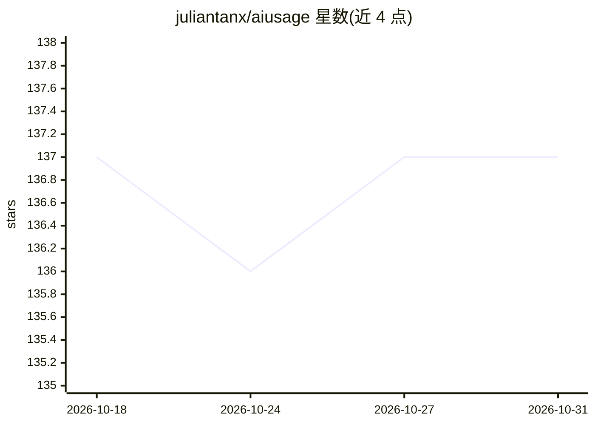

# juliantanx/aiusage

⭐ 137 · TypeScript · MIT · 推送 2026-10-22 · [GitHub](https://github.com/juliantanx/aiusage) · [官网](https://www.npmjs.com/package/@juliantanx/aiusage) · 个人维护 · 中文 README

**本地优先的 AI 编码助手用量追踪面板**

面向使用 AI 编码工具的开发者：解析 20+ 工具（Claude Code、Codex、Cursor、Copilot、Gemini CLI 等）的本地日志，在单一本地仪表盘中统计 token、成本、会话、模型、项目、工具调用与配额压力。以 npm CLI 提供，运行 `aiusage serve` 启动本地 Web UI（端口 3847），本地模式无需账号、不发送遥测。支持 GitHub/S3/R2/MinIO 可选同步、可选公开排行榜与桌面托盘小组件；成本为基于定价元数据的估算值，历史数据依赖各工具是否保留源日志。

## 筛选速览

| 维度 | 判定 | 备注 |
|---|---|---|
| AI 角色 | `ai-ecosystem` | LLM/agent 周边工具 |
| 许可风险 | `permissive` | MIT |
| 部署形态 | `self-host` | docker 或自建部署 |
| 模型依赖 | — | README 未给出锁定关系 |
| 硬件要求 | — | 无带数字的原话,不猜 |
| 安装摩擦 | `low` | 无编译、无系统依赖或容器化 |
| 成熟度 | — | 结构信号不足 |

## 能力要点

- 解析 20+ AI 编码工具本地日志，本地仪表盘统一展示 token/成本/会话/配额
- 本地优先：无需账号、无遥测，不上传提示词/补全/源码/文件路径
- 可选 GitHub/S3/R2/MinIO 跨设备同步与可选公开排行榜
- 桌面托盘小组件与 CSV 导出、PM2 后台服务

## 适用场景

- 在一个面板里查看多个 AI 编码助手的 token 与成本开销
- 多设备间同步自己的 AI 用量数据
- 通过公开排行榜比较聚合用量排名

## 场景标签

`LLM 可观测性` · 领域:评测与运维

## 证据(README 行号)

> L16: Track tokens, cost, sessions, models, projects, tool calls, and quota pressure across **20+ AI coding tools** in on
> L22: - **One local dashboard** for tokens, cost, sessions, models, projects, tool calls, and quotas.

## 星数曲线

2026-10-18 137 → 2026-10-31 137（+0）

---
*卡片 v1 · prompt 1.4 · 生成 2026-10-22 · 置信度 high · 依据 README sha `5a68a8078580` · [字段定义](../../DATASET.md)*
