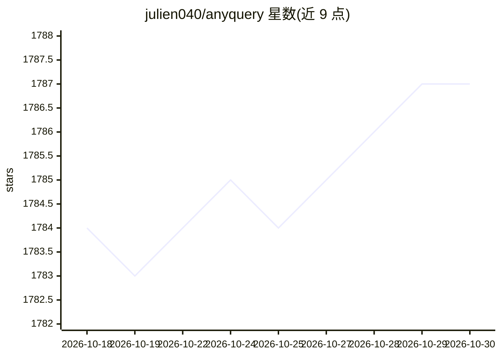

# julien040/anyquery

⭐ 1,787 · Go · NOASSERTION · 推送 2026-10-08 · [GitHub](https://github.com/julien040/anyquery) · [官网](https://anyquery.dev) · 个人维护

**用 SQL 查询 60+ 工具与文件数据的引擎，可接入 LLM**

基于 SQLite 的 SQL 查询引擎，通过插件把文件、数据库与各类应用（如 Apple Notes、Notion、Chrome、Todoist、GitHub、Airtable）统一为可 SQL 查询的表，可加载任意 SQLite 扩展。它可作为 MySQL 服务器供 TablePlus、Metabase 等客户端连接，也可通过 MCP 协议或函数调用（anyquery mcp / anyquery gpt）让 ChatGPT、Claude、Cursor 等 LLM 访问用户数据。用 Go 编写，提供 macOS/Linux/Windows 的包管理器安装与二进制下载，核心引擎 AGPLv3、RPC 库 MIT。

## 筛选速览

| 维度 | 判定 | 备注 |
|---|---|---|
| AI 角色 | `ai-ecosystem` | LLM/agent 周边工具 |
| 许可风险 | `none` | NOASSERTION |
| 部署形态 | `desktop` | 安装包/桌面程序 |
| 模型依赖 | — | README 未给出锁定关系 |
| 硬件要求 | — | 无带数字的原话,不猜 |
| 安装摩擦 | `low` | 无编译、无系统依赖或容器化 |
| 成熟度 | — | 结构信号不足 |

## 能力要点

- SQL 查询文件、数据库与 60+ 应用（Notion、GitHub、Airtable、Apple Notes 等）
- 可作为 MCP 服务器或函数调用端点供 LLM 访问数据
- 可作为 MySQL 服务器连接 TablePlus、Metabase 等客户端
- 插件体系，支持官方注册表插件与自定义插件、任意 SQLite 扩展

## 适用场景

- 用熟悉的 SQL 客户端统一查询 Notion、GitHub 等应用数据
- 让 ChatGPT/Claude 等 LLM 通过 MCP 读取我的本地与应用数据
- 把分散的工具数据接入 BI 工具做分析

## 场景标签

`数据分析` · 领域:效率与自动化

## 证据(README 行号)

> L23: Anyquery is a SQL query engine that allows you to run SQL queries on pretty much anything. It supports querying fil
> L25: It can also connect to LLMs (e.g. ChatGPT, Claude, Cursor, TypingMind, etc.) to allow them to access your data.
> L35: LLMs can connect to Anyquery using the Model Context Protocol (MCP). This protocol provides context for LLMs that s

## 星数曲线

2026-10-18 1,784 → 2026-10-30 1,787（+3）

---
*卡片 v1 · prompt 1.4 · 生成 2026-10-21 · 置信度 high · 依据 README sha `4593b065588a` · [字段定义](../../DATASET.md)*
