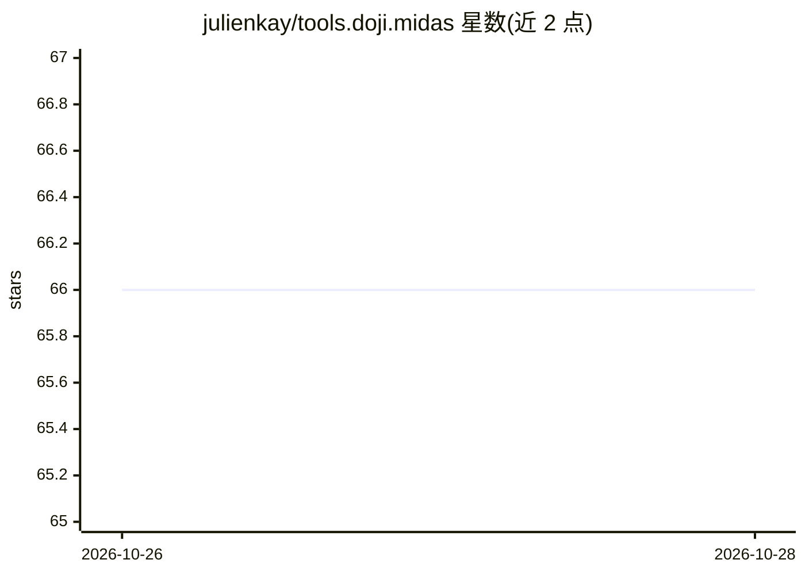

# julienkay/tools.doji.midas

⭐ 66 · C# · MIT · 推送 2026-10-25 · [GitHub](https://github.com/julienkay/tools.doji.midas) · 组织维护

**Unity 中运行 MiDaS 单目深度估计的 Sentis 资产包**

基于 Unity Sentis 推理引擎运行 MiDaS 模型的 Unity 资产，从单张图像生成单目深度估计（ONNX 格式模型），面向在 Unity 项目中集成深度估计功能的开发者。项目采用双许可：GitHub 上以 MIT License 提供，同时在 Unity Asset Store 付费发售；也可通过 OpenUPM 获取。使用方法与文档另附于外部链接，README 本体不含使用细节。

## 筛选速览

| 维度 | 判定 | 备注 |
|---|---|---|
| AI 角色 | `ai-native` | 本体是模型或模型工具 |
| 许可风险 | `permissive` | MIT |
| 部署形态 | `None` |  |
| 模型依赖 | — | README 未给出锁定关系 |
| 硬件要求 | — | 无带数字的原话,不猜 |
| 安装摩擦 | `low` | 无编译、无系统依赖或容器化 |
| 成熟度 | — | 结构信号不足 |

## 能力要点

- 通过 Unity Sentis 推理引擎运行 MiDaS 模型
- 从单张图像生成单目深度估计
- MIT License 与 Unity Asset Store 双许可分发
- 可通过 OpenUPM 或 Asset Store 获取

## 适用场景

- 在 Unity 游戏或应用中为图像添加深度估计能力
- 原型验证 MiDaS 模型在 Unity Sentis 上的运行效果

## 场景标签

`图像视频处理` · 领域:感知与多模态

## 证据(README 行号)

> L6: Monocular Depth Estimation with Unity Inference Engine using MiDaS[^1] models

## 星数曲线

2026-10-26 66 → 2026-10-28 66（+0）

---
*卡片 v1 · prompt 1.4 · 生成 2026-10-27 · 置信度 mid · 依据 README sha `459d1826ea7b` · [字段定义](../../DATASET.md)*
