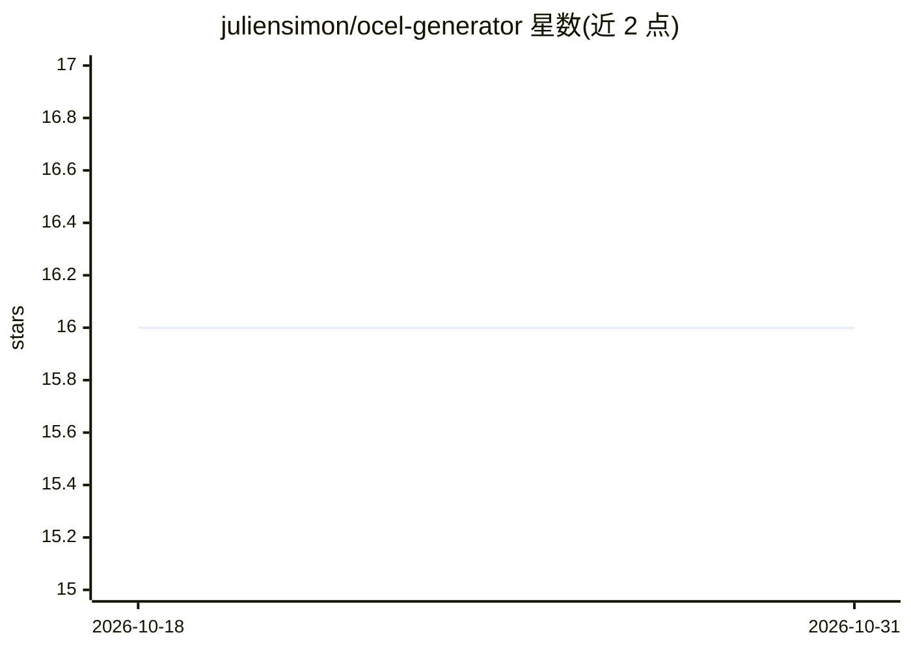

# juliensimon/ocel-generator

⭐ 16 · Python · MIT · 推送 2026-04-08 · [GitHub](https://github.com/juliensimon/ocel-generator) · [官网](https://huggingface.co/datasets/juliensimon/open-agent-traces) · 个人维护

**生成多智能体工作流 OCEL 2.0 轨迹数据的 Python 工具**

面向 agent 可观测团队、ML 与过程挖掘研究者的轨迹数据生成器：按 sequential/supervisor/parallel 三种模式与 10 个内置企业领域（可用 YAML 自定义）生成符合 OCEL 2.0 的多智能体事件日志，含 LLM 提示与补全、工具调用、token 计数与成本估算；支持注入 10 类带真值标签的偏差用于异常检测研究，并可接任意 OpenAI 兼容端点（默认 OpenRouter）做内容增强。生成结果经 5 层验证并可直接载入 PM4Py，另提供 HF 上 17,000+ 事件的预置数据集。结构轨迹无需 API key。

## 筛选速览

| 维度 | 判定 | 备注 |
|---|---|---|
| AI 角色 | `ai-ecosystem` | LLM/agent 周边工具 |
| 许可风险 | `permissive` | MIT |
| 部署形态 | `library` | 以包/库形式分发 |
| 模型依赖 | — | README 未给出锁定关系 |
| 硬件要求 | — | 无带数字的原话,不猜 |
| 安装摩擦 | `low` | 无编译、无系统依赖或容器化 |
| 成熟度 | — | 结构信号不足 |

## 能力要点

- 3 种工作流模式、10 个内置领域、YAML 自定义领域
- 10 类带真值标签的偏差注入，用于异常检测训练
- 5 层语义验证（JSON Schema、引用完整性、时序等）
- 输出兼容 PM4Py，可载入 OCEL 2.0 过程挖掘

## 适用场景

- 为 agent 监控看手构建与测试生成真实感轨迹数据
- 训练带标签的 agent 工作流异常检测模型
- 对多智能体系统做 OCEL 2.0 一致性检查研究

## 场景标签

 · 领域:AI 数据工具/过程挖掘

## 证据(README 行号)

> L3: **Generate realistic multi-agent workflow traces on demand.** Any domain, any pattern, any LLM. Validated against OC
> L58: Plug in any OpenAI-compatible endpoint to fill traces with realistic content:
> L127: - **Agent observability teams** — build and test monitoring dashboards with realistic trace data

## 星数曲线

2026-10-18 16 → 2026-10-31 16（+0）

---
*卡片 v1 · prompt 1.4 · 生成 2026-10-30 · 置信度 high · 依据 README sha `e05fe53aa71c` · [字段定义](../../DATASET.md)*
