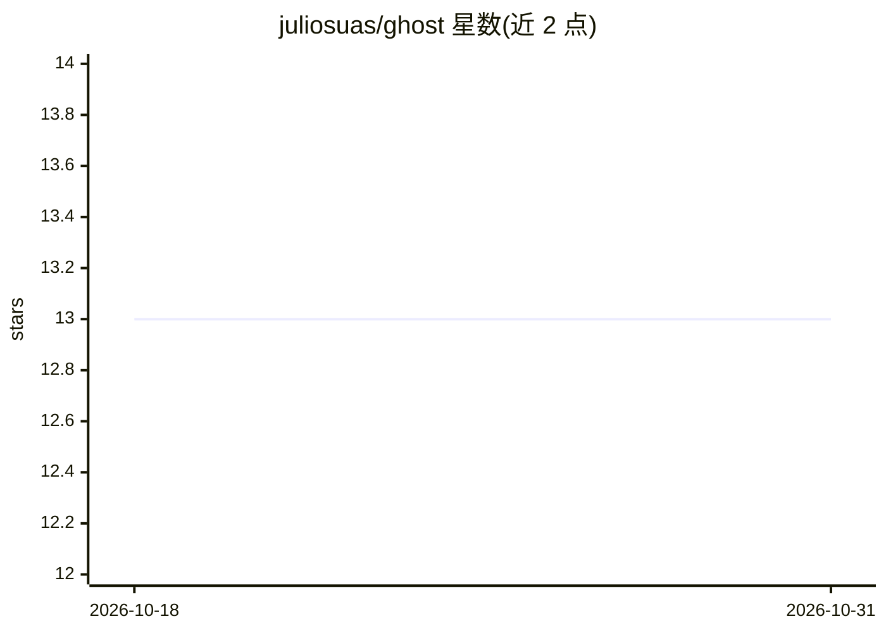

# juliosuas/ghost

⭐ 13 · Python · MIT · 推送 2026-10-23 · [GitHub](https://github.com/juliosuas/ghost) · [官网](https://github.com/juliosuas/ghost) · 个人维护

**本地授权 OSINT 调查工作台：单目标多向量取证与带出处的报告**

面向授权自审场景的本地 OSINT 案件档案工作台（Python 3.10+）：对单一目标（用户名/邮箱/电话/域名/照片）运行可选模块，结果存入 SQLite 案件文件，记录授权与范围，生成带 provenance 的 HTML/JSON/PDF 报告。内置 70 个平台用户名 HTTP 存在性检查，可选接入 Sherlock 扩展覆盖。OpenAI 分析为可选（需 OPENAI_API_KEY），--no-ai 走确定性启发式。提供 CLI、Flask REST API（默认仅回环）与 Docker 部署；PyPI 包未发布，需源码安装。

## 筛选速览

| 维度 | 判定 | 备注 |
|---|---|---|
| AI 角色 | `ai-enhanced` | 去掉 AI 部分产品仍成立 |
| 许可风险 | `permissive` | MIT |
| 部署形态 | `self-host` | docker 或自建部署 |
| 模型依赖 | — | README 未给出锁定关系 |
| 硬件要求 | — | 无带数字的原话,不猜 |
| 安装摩擦 | `low` | 无编译、无系统依赖或容器化 |
| 成熟度 | `idea` | |

## 能力要点

- SQLite 案件文件存储，记录授权与范围，报告含 provenance 溯源
- 7 类调查向量：用户名（70 平台）、邮箱、电话、域名、图像、社交、暗网（后两类默认关闭且实验性）
- AI 关联分析为可选（OpenAI），--no-ai 使用确定性启发式
- ghost doctor 暴露面检查，默认回环绑定、API 需 token

## 适用场景

- 对自己持有的账号做授权自审并留存可导出的证据档案
- 对单一授权目标做多向量 OSINT 调查并生成带出处的报告
- 导入 Sherlock 等工具的本地报告形成案件档案

## 场景标签

`网络安全` · 领域:学习与行业

## 证据(README 行号)

> L17: *Run an authorized local investigation from a single target (username, email, phone, domain, or photo), store it as
> L31: |**Optional AI correlation**|OpenAI when configured; `--no-ai` uses deterministic heuristics|No|
> L65: - 🤖 **Optional AI correlation** — OpenAI analysis only when `OPENAI_API_KEY` is set; `--no-ai` uses deterministic h

## 星数曲线

2026-10-18 13 → 2026-10-31 13（+0）

---
*卡片 v1 · prompt 1.4 · 生成 2026-10-31 · 置信度 mid · 依据 README sha `4ce589d27bdc` · [字段定义](../../DATASET.md)*
