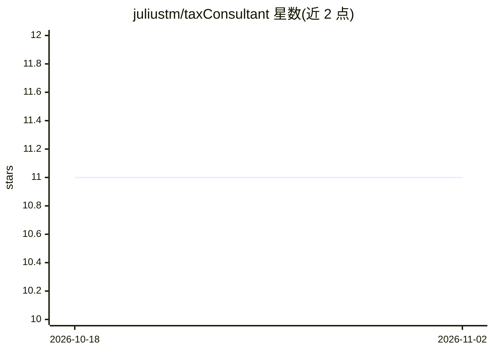

# juliustm/taxConsultant

⭐ 11 · Python · AGPL-3.0 · 推送 2026-09-02 · [GitHub](https://github.com/juliustm/taxConsultant) · [官网](https://karani.atana.co.tz) · 个人维护

**坦桑尼亚企业的 EFD 收据采集与税务分析自托管 AI 代理**

面向坦桑尼亚企业的自托管开源代理：通过 WhatsApp/Telegram/Web/手机扫码 App 多渠道接收 EFD 收据，将 QR 码 URL 对接 TRA 门户验证并解析结构化字段（TIN、税额、行项目等），导出至 Google Sheets、S3 或 Webhook。LLM（Groq、OpenAI）仅做判断性分析（费用分类、抵扣、进项 VAT），金额与日期来自解析页面而非模型；另提供合规评分、VAT 台账、供应商画像与离线优先的扫码 App。采用 AGPL v3 加商业许可双许可。

## 筛选速览

| 维度 | 判定 | 备注 |
|---|---|---|
| AI 角色 | `ai-native` | 本体是模型或模型工具 |
| 许可风险 | `dual` | AGPL-3.0 |
| 部署形态 | `self-host` | docker 或自建部署 |
| 模型依赖 | locked-api |  |
| 硬件要求 | — | 无带数字的原话,不猜 |
| 安装摩擦 | `low` | 无编译、无系统依赖或容器化 |
| 成熟度 | — | 结构信号不足 |

## 能力要点

- 收据 QR 码对接 TRA 门户验证并精确解析结构化字段
- LLM 仅做分类与抵扣判断，不可编造日期金额
- 0-100 合规评分与 VAT 可追回计算（确定性规则，utils/compliance.py）
- 离线优先的手机扫码 App（IndexedDB 队列、无 CDN 依赖）

## 适用场景

- 我想让员工在店里扫码上传收据，自动记账到 Google Sheets
- 我想按坦桑尼亚 VAT/WHT 规则自动核查每张收据能否抵扣
- 我想在审计前导出完整的收据数据与合规报告

## 场景标签

`文档解析` `数据分析` · 领域:效率与自动化

## 证据(README 行号)

> L6: An open-source, self-hostable AI agent designed to help Tanzanian businesses automate and simplify expense reporting
> L30: - **AI for Judgment, Not Facts**: The LLM (Groq, OpenAI) is given the parsed JSON and asked only what the purchase 

## 星数曲线

2026-10-18 11 → 2026-11-02 11（+0）

---
*卡片 v1 · prompt 1.4 · 生成 2026-11-02 · 置信度 mid · 依据 README sha `2ea6c6ad3493` · [字段定义](../../DATASET.md)*
