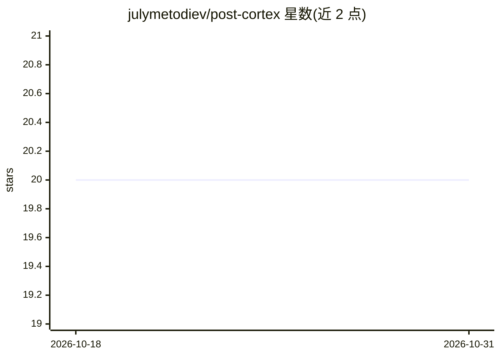

# julymetodiev/post-cortex

⭐ 20 · Rust · MIT · 推送 2026-10-20 · [GitHub](https://github.com/julymetodiev/post-cortex) · [官网](https://369.is) · 个人维护

**给 AI 助手提供持久长期记忆的 Rust MCP 服务器**

Post-Cortex 是一个用 Rust 编写的 MCP 服务器，为 AI 助手（如 Claude Code）提供跨会话的持久记忆：存储对话、决策与洞察，自动抽取实体并维护同步的知识图谱，支持向量+BM25 混合检索（RRR 融合、可选重排）、Graph-RAG 图遍历、项目卡片与作者归属。默认嵌入模型 potion-multilingual-128M（约 50MB）本地运行，存储用嵌入式 RocksDB 或可选 SurrealDB。提供 9 个 MCP 工具、pcx CLI、守护进程模式、敏感信息脱敏与导出/导入。以 Cargo workspace 的 8 个可发布 crate 组织，MIT 许可。

## 筛选速览

| 维度 | 判定 | 备注 |
|---|---|---|
| AI 角色 | `ai-ecosystem` | LLM/agent 周边工具 |
| 许可风险 | `permissive` | MIT |
| 部署形态 | `library` | 以包/库形式分发 |
| 模型依赖 | — | README 未给出锁定关系 |
| 硬件要求 | — | 无带数字的原话,不猜 |
| 安装摩擦 | `medium` | 含编译或系统依赖之一 |
| 成熟度 | — | 结构信号不足 |

## 能力要点

- 向量+BM25 混合检索与 Graph-RAG 实体图遍历
- 默认本地嵌入模型 potion-multilingual-128M（约 50MB，多语言）
- RocksDB 嵌入式存储（可选 SurrealDB 分布式后端）
- 写入前自动脱敏凭据/邮箱/电话/IP，处理全程本地

## 适用场景

- 让 Claude Code 等助手的对话与决策跨会话留存
- 多个助手实例通过守护进程共享同一记忆库
- 对会话知识做语义搜索与实体关系查询

## 场景标签

`Agent 记忆` `知识图谱` `语义搜索` · 领域:Agent 开发

## 证据(README 行号)

> L7: Post-Cortex is an MCP server that gives AI assistants long-term memory. It stores conversations, decisions, and insi
> L23: - **Privacy-first** — all processing runs locally (the embedding and reranker models are downloaded from Hugging Fa

## 星数曲线

2026-10-18 20 → 2026-10-31 20（+0）

---
*卡片 v1 · prompt 1.4 · 生成 2026-10-28 · 置信度 high · 依据 README sha `7348d67f84d6` · [字段定义](../../DATASET.md)*
