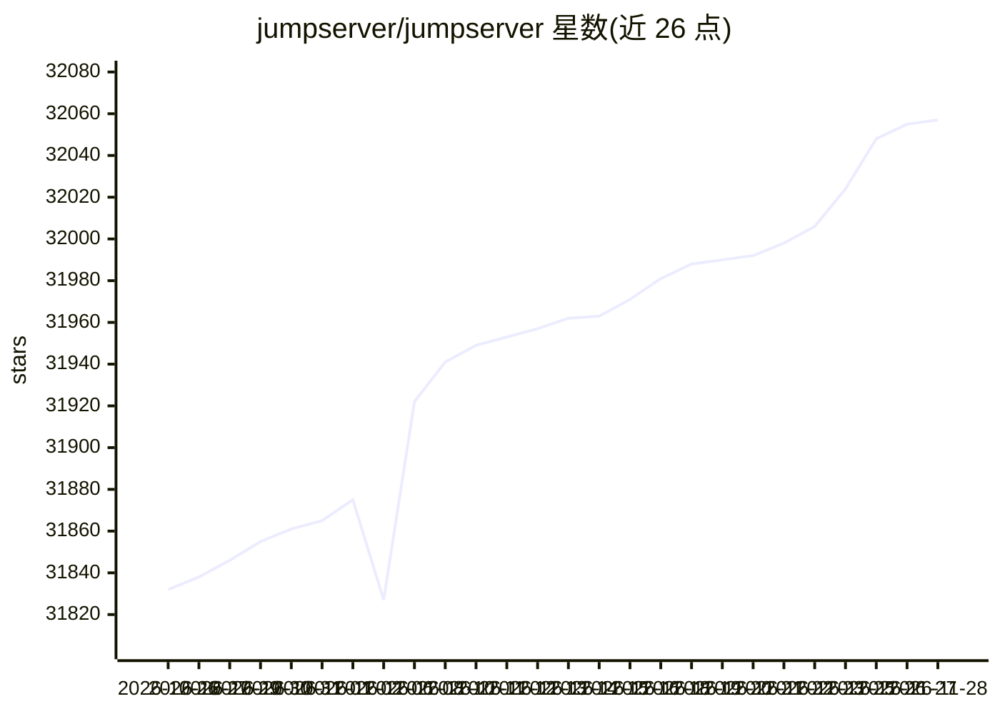

# jumpserver/jumpserver

⭐ 32,057 · Python · GPL-3.0 · 推送 2026-11-27 · [GitHub](https://github.com/jumpserver/jumpserver) · [官网](https://jumpserver.com) · 组织维护 · 中文 README

**面向 DevOps/IT 团队的开源 PAM 堡垒机平台，带 AI 能力**

开源特权访问管理（PAM）平台，即堡垒机：为 DevOps 与 IT 团队提供统一工作区，安全接入 SSH、RDP、Kubernetes、数据库、网站、RemoteApp、VirtualApp 等资产。组件按角色划分：核心项目含 Web 界面（Lina）、Web 终端（Luna）、协议连接代理（KoKo）、数据库连接器（Chen）与 AI 组件（Kael）；企业组件扩展 Windows 应用、RDP、数据库、VNC 代理等接入。快速入门要求 64 位 Linux 服务器（≥4 核 8 GB），通过官方脚本一键部署后经浏览器访问。版本维护分 5.x、4.10.x LTS 与 3.10.x，V3 社区版/企业版分别公布生命周期终止日期。

## 筛选速览

| 维度 | 判定 | 备注 |
|---|---|---|
| AI 角色 | `ai-enhanced` | 去掉 AI 部分产品仍成立 |
| 许可风险 | `viral` | GPL-3.0 |
| 部署形态 | `None` |  |
| 模型依赖 | — | README 未给出锁定关系 |
| 硬件要求 | — | 无带数字的原话,不猜 |
| 安装摩擦 | `low` | 无编译、无系统依赖或容器化 |
| 成熟度 | — | 结构信号不足 |

## 动量与使用信号

- 维护:`active` — 距上次 push 1.9 天,年发版 15,126 位贡献者
- 涨星:近 1 天 **+6**(自 20261016 起算)
- 平台:LINUX / WEB · 协议:—

## 能力要点

- 统一接入 SSH、RDP、Kubernetes、数据库、RemoteApp、VirtualApp 等多种资产
- Kael AI 组件提供终端 AI 提示与 AI 助手（截图展示）
- KoKo TUI 支持多 SSH 会话管理与可搜索的授权资产列表
- 提供 11 种语言文档与一键部署脚本

## 适用场景

- 为企业服务器和数据库统一管控特权访问并留存会话审计
- IT 团队通过堡垒机代理接入 RDP/VNC/应用等异构资源
- 运维团队借助内置 AI 助手处理终端操作

## 场景标签

 · 领域:企业 IT/安全运维

## 证据(README 行号)

> L17: JumpServer is an open-source Privileged Access Management (PAM) platform with AI-powered capabilities. It gives Dev
> L59: JumpServer groups its components by role. Core projects provide the platform, web interface, terminal, protocol con
> L89:  JumpServer AI component

## 星数曲线

2026-10-26 31,832 → 2026-11-28 32,057（+225）

---
*卡片 v1 · prompt 1.4 · 生成 2026-11-28 · 置信度 high · 依据 README sha `920467e9454b` · [字段定义](../../DATASET.md)*
