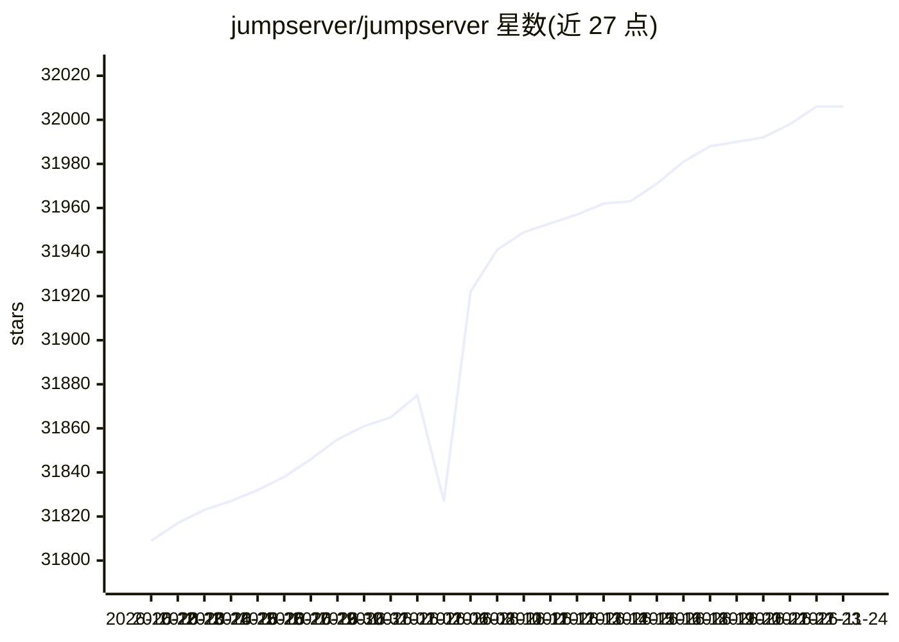

# jumpserver/jumpserver

⭐ 32,006 · Python · GPL-3.0 · 推送 2026-11-20 · [GitHub](https://github.com/jumpserver/jumpserver) · [官网](https://jumpserver.com) · 组织维护 · 中文 README

**面向 DevOps 与 IT 团队的开源 PAM 堡垒机平台（带 AI 能力）**

开源特权访问管理（PAM）平台，即堡垒主机，为 SSH、RDP、Kubernetes、数据库、网站、RemoteApp、VirtualApp 等资产提供统一的安全访问入口。由多组件构成：Lina Web 界面、Luna Web 终端与原生客户端、KoKo 协议连接器与代理、Chen 数据库连接器、Kael AI 组件；企业版另含 Windows 应用连接器、RDP/数据库/VNC 协议代理与会话录制转码等。提供一键安装脚本，要求 64 位 Linux、4 核 CPU、8 GB 内存。

## 筛选速览

| 维度 | 判定 | 备注 |
|---|---|---|
| AI 角色 | `ai-enhanced` | 去掉 AI 部分产品仍成立 |
| 许可风险 | `viral` | GPL-3.0 |
| 部署形态 | `None` |  |
| 模型依赖 | — | README 未给出锁定关系 |
| 硬件要求 | — | 无带数字的原话,不猜 |
| 安装摩擦 | `low` | 无编译、无系统依赖或容器化 |
| 成熟度 | — | 结构信号不足 |

## 动量与使用信号

- 维护:`active` — 距上次 push 1.9 天,年发版 15,126 位贡献者
- 涨星:近 1 天 **+6**(自 20261016 起算)
- 平台:LINUX / WEB · 协议:—

## 能力要点

- 统一入口访问 SSH、RDP、Kubernetes、数据库、网站、RemoteApp、VirtualApp
- Kael 为其 AI 组件，界面含终端 AI 提示与 AI 助手
- 多组件架构：Lina/Luna/KoKo/Chen/Kael 等核心项目
- 多语言 README 与社区（Discord）渠道

## 适用场景

- 为运维团队集中管理与审计对服务器和数据库的特权访问
- 统一接入 Kubernetes 与远程桌面等异构资产
- 搭建堡垒机并录制会话

## 场景标签

 · 领域:网络安全/IT运维

## 证据(README 行号)

> L17: JumpServer is an open-source Privileged Access Management (PAM) platform with AI-powered capabilities. It gives Dev
> L59: JumpServer groups its components by role. Core projects provide the platform, web interface, terminal, protocol con
> L87:  Kael

## 星数曲线

2026-10-22 31,809 → 2026-11-24 32,006（+197）

---
*卡片 v1 · prompt 1.4 · 生成 2026-11-22 · 置信度 high · 依据 README sha `81d5ce4c635b` · [字段定义](../../DATASET.md)*
