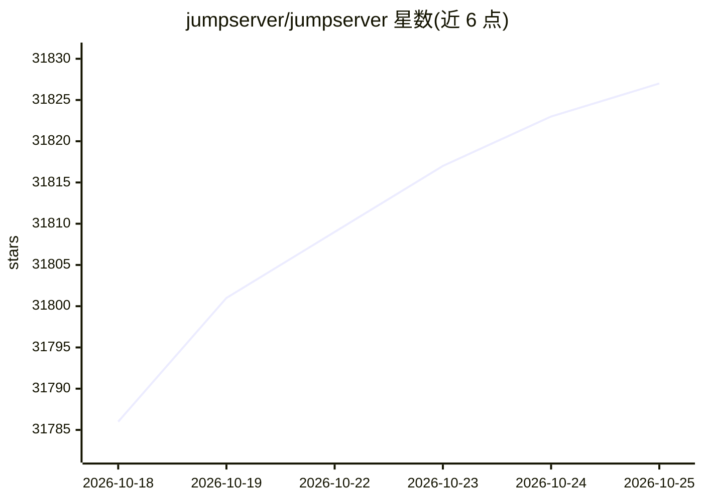

# jumpserver/jumpserver

⭐ 31,832 · Python · GPL-3.0 · 推送 2026-10-23 · [GitHub](https://github.com/jumpserver/jumpserver) · [官网](https://jumpserver.com) · 组织维护 · 中文 README

**为 DevOps/IT 团队提供带 AI 能力的开源堡垒机（PAM）平台**

JumpServer 是开源的特权访问管理（PAM）平台，即堡垒主机。它为 DevOps 与 IT 团队提供统一工作区，安全接入 SSH、RDP、Kubernetes、数据库、网站、RemoteApp、VirtualApp 等资产。采用多组件架构：JumpServer 核心平台、Lina Web 界面、Luna Web 终端与原生客户端、KoKo 协议连接代理、Chen 数据库连接器、Kael AI 组件；另有企业版组件（Windows 应用连接器、RDP/数据库/VNC 协议代理、会话录像转码等）。支持 11 种语言界面，通过一键脚本在 64 位 Linux 服务器上部署，默认管理员账号 admin。

## 筛选速览

| 维度 | 判定 | 备注 |
|---|---|---|
| AI 角色 | `ai-enhanced` | 去掉 AI 部分产品仍成立 |
| 许可风险 | `viral` | GPL-3.0 |
| 部署形态 | `None` |  |
| 模型依赖 | — | README 未给出锁定关系 |
| 硬件要求 | — | 无带数字的原话,不猜 |
| 安装摩擦 | `low` | 无编译、无系统依赖或容器化 |
| 成熟度 | — | 结构信号不足 |

## 动量与使用信号

- 维护:`active` — 距上次 push 1.9 天,年发版 15,126 位贡献者
- 涨星:近 1 天 **+6**(自 20261016 起算)
- 平台:LINUX / WEB · 协议:—

## 能力要点

- 统一接入 SSH、RDP、Kubernetes、数据库、网站、RemoteApp、VirtualApp 等多种协议与资产
- 内置 AI 能力：终端 AI 提示与 AI 助手（Kael 组件）
- KoKo TUI 终端支持资产搜索与多会话管理
- 组件化架构，社区版与企业版组件分层

## 适用场景

- 为企业服务器与数据库的特权访问做集中审计与管控
- 运维团队通过 Web 终端/原生客户端统一管理大量资产
- 替代手工分发凭据，按授权分配可访问目标

## 场景标签

 · 领域:网络安全/运维工具

## 证据(README 行号)

> L17: JumpServer is an open-source Privileged Access Management (PAM) platform with AI-powered capabilities. It gives Dev
> L83:  JumpServer AI component
> L142: Copyright (c) 2014-2026 FIT2CLOUD, All rights reserved.

## 星数曲线

2026-10-18 31,786 → 2026-10-25 31,827（+41）

---
*卡片 v1 · prompt 1.4 · 生成 2026-10-18 · 置信度 high · 依据 README sha `935261dffc73` · [字段定义](../../DATASET.md)*
