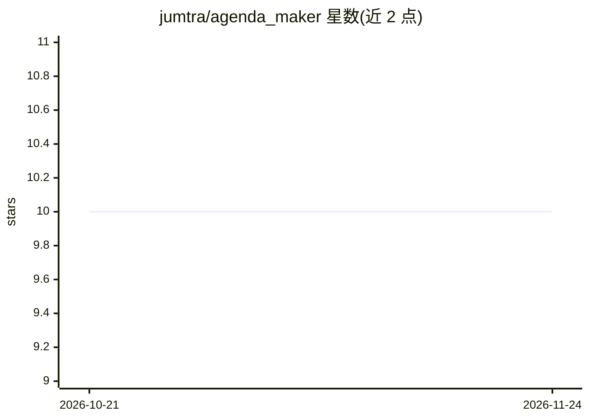

# jumtra/agenda_maker

⭐ 10 · Python · 推送 2026-07-19 · [GitHub](https://github.com/jumtra/agenda_maker) · 个人维护

**本地运行的日语会议纪要生成库：音频转写并摘要**

从音视频数据自动生成日语会议纪要的 Python 库：经 WhisperX 完成文字转写与说话人分离，用 SentenceTransformer 做文本分段，再以 ELYZA-Llama 2（llama-cpp-python 加载 GGUF 模型）完成摘要与文本校对，输出成稿纪要。提供 CLI 与 gradio 两种运行方式，支持 Docker（make prepare/start/stop）与本地 poetry 安装；本地部署需 Python 3.10、FFmpeg，并配置 Hugging Face token 下载模型。

## 筛选速览

| 维度 | 判定 | 备注 |
|---|---|---|
| AI 角色 | `ai-native` | 本体是模型或模型工具 |
| 许可风险 | `none` | — |
| 部署形态 | `library` | 以包/库形式分发 |
| 模型依赖 | local-ok | 支持本地模型 |
| 硬件要求 | — | 无带数字的原话,不猜 |
| 安装摩擦 | `low` | 无编译、无系统依赖或容器化 |
| 成熟度 | — | 结构信号不足 |

## 能力要点

- WhisperX 文字转写与说话人自动分离
- SentenceTransformer 分段 + ELYZA-Llama 2 摘要与校对
- CLI 与 gradio 两种运行方式
- Docker 与本地 poetry 两种部署路径

## 适用场景

- 将日语会议录音自动整理为纪要
- 本地处理含说话人分离需求的音视频转文字任务
- 需要摘要与文本校对的日语语音处理流水线

## 场景标签

`语音识别` `AI 写作` · 领域:内容生成

## 证据(README 行号)

> L9: このプロジェクトは、音声・動画データから議事録を自動生成するためのライブラリです。具体的には、音声データから文字起こし、話者割り当て、テキストセグメンテーション、要約を行い、最終的には生成された議事録を出力します。
> L13: * 文字起こし：WhisperXを使用して、音声データからテキストへの変換を行います。
> L16: * 要約：LLama2 ELYZAを使用して、生成されたテキストを要約します。

## 星数曲线

2026-10-21 10 → 2026-11-24 10（+0）

---
*卡片 v1 · prompt 1.4 · 生成 2026-11-19 · 置信度 high · 依据 README sha `924592df4dd8` · [字段定义](../../DATASET.md)*
