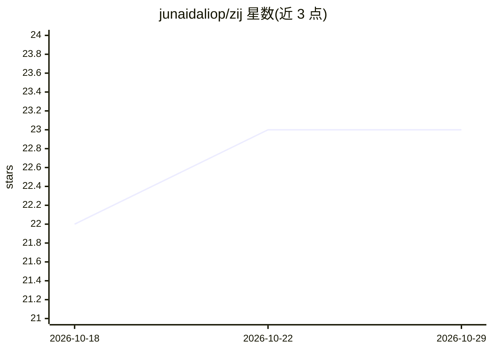

# junaidaliop/zij

⭐ 23 · Python · Apache-2.0 · 推送 2026-06-18 · [GitHub](https://github.com/junaidaliop/zij) · [官网](https://junaidaliop.github.io/zij/) · 个人维护

**深度学习优化器合集：740 个方法的目录加 106 个可运行 PyTorch 实现**

面向深度学习研究者的优化器知识库与工具库的组合：以 Canon 表格收录 740 个优化方法（跨 11 类，记录名称、发表场所、论文与可用实现），同时提供 PyTorch 包 zij，内置 106 个可直接使用的优化器（zij.core 镜像 torch.optim v2.12.0，zij.contrib 收录一阶/二阶/内存高效/免学习率/锐度感知等研究方法）。部分方法仅列目录未实现（论文许可限制或尚未移植）。当前仅支持 PyTorch，JAX/TensorFlow 移植为计划项。

## 筛选速览

| 维度 | 判定 | 备注 |
|---|---|---|
| AI 角色 | `ai-ecosystem` | LLM/agent 周边工具 |
| 许可风险 | `permissive` | Apache-2.0 |
| 部署形态 | `library` | 以包/库形式分发 |
| 模型依赖 | — | README 未给出锁定关系 |
| 硬件要求 | — | 无带数字的原话,不猜 |
| 安装摩擦 | `low` | 无编译、无系统依赖或容器化 |
| 成熟度 | — | 结构信号不足 |

## 能力要点

- Canon 表覆盖 740 个优化方法、11 个类别，含论文与实现出处
- PyTorch 包内置 106 个优化器，zij.core 镜像 torch.optim v2.12.0
- zij.contrib 按家族组织研究方法（二阶、免学习率、锐度感知等）
- pip install zij 即可安装，镜像 torch.optim API

## 适用场景

- 训练模型时查找并替换不同的优化器进行实验
- 调研某优化方法的论文出处与可用实现
- 比较各优化器家族的覆盖情况以选择研究基线

## 场景标签

`精选清单` · 领域:学习与行业

## 证据(README 行号)

> L16: This project takes the name in that spirit. It gathers the equation, the paper,
> L57: The PyTorch package ships 106 ready-to-use optimizers. `zij.core` mirrors

## 星数曲线

2026-10-18 22 → 2026-10-29 23（+1）

---
*卡片 v1 · prompt 1.4 · 生成 2026-10-27 · 置信度 high · 依据 README sha `f0c4271d7154` · [字段定义](../../DATASET.md)*
