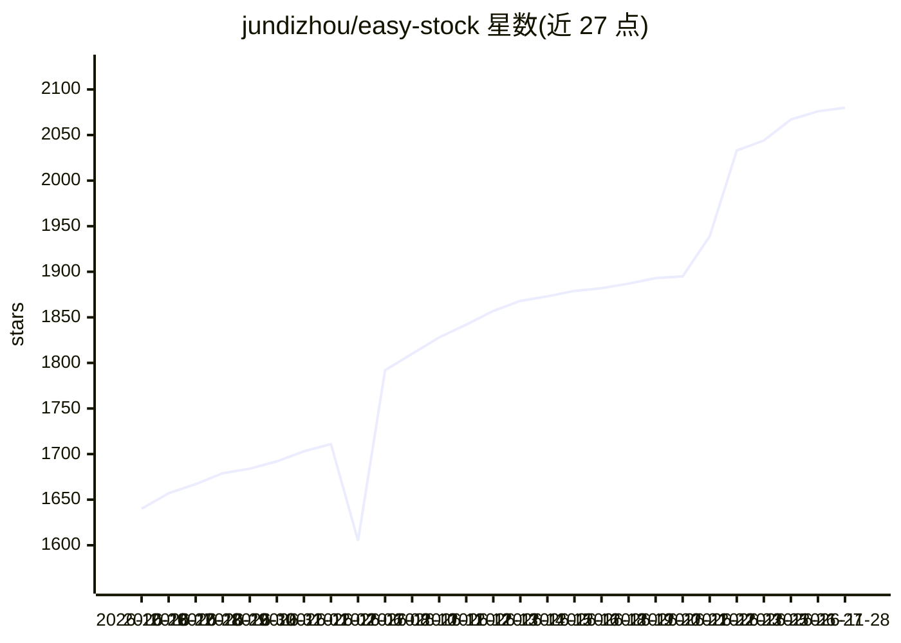

# jundizhou/easy-stock

⭐ 2,080 · Go · NOASSERTION · 推送 2026-11-25 · [GitHub](https://github.com/jundizhou/easy-stock) · [官网](https://github.com/jundizhou/easy-stock/blob/main/docs/user-guide.md) · 个人维护 · 中文 README

**A股投资者的 AI 投研工作台，覆盖行情到持仓**

基于 Electron + React + Go 的桌面应用，将行情总览、趋势题材、短线连板、个股分级研究、持仓巡检与 AI 持仓优化整合为研究流程。数据聚合开盘啦、东方财富、新浪、财联社等来源，通过统一 Agent 服务选择 Hermes 或 Codex 运行时生成个股研判、组合评分与观点共识，保留评分维度、来源地址与时间供核验。报告与本机研究记忆存于 SQLite。用户需自行配置大模型 API Key；仅供学习研究，不构成投资建议，许可证禁止商业用途。

## 筛选速览

| 维度 | 判定 | 备注 |
|---|---|---|
| AI 角色 | `ai-native` | 本体是模型或模型工具 |
| 许可风险 | `none` | NOASSERTION |
| 部署形态 | `None` |  |
| 模型依赖 | locked-api |  |
| 硬件要求 | — | 无带数字的原话,不猜 |
| 安装摩擦 | `low` | 无编译、无系统依赖或容器化 |
| 成熟度 | — | 结构信号不足 |

## 能力要点

- 个股分级研究：量化速览、AI 快速/标准/深度研判四种方式
- 持仓巡检四维评分（逻辑 35%/结构 25%/风险 25%/策略 15%）与 AI 持仓优化对照
- 大 V 复盘自动同步雪球、淘股吧并生成观点共识，支持定时任务与飞书/钉钉通知
- 统一 Agent 服务共享模型连接、Skills 与 MCP，可配置多家模型服务商

## 适用场景

- 盘后自动收集多位市场作者的复盘文章并提炼共识与分歧
- 对自选股票做带证据引用的分级 AI 研究
- 定期巡检持仓组合的四维评分与风险
- 比较原持仓与 AI 建议组合的仓位调整方案

## 场景标签

`金融量化` · 领域:学习与行业

## 证据(README 行号)

> L48: easy-stock 希望构建一套真正理解 A股语境的 AI 原生工作台，把行情分析、题材研究、股票分析、盘后复盘与可追溯证据整合为统一的研究流程：
> L227: AI 会话经过本机统一 Agent 服务，可选择 Hermes 或 Codex 运行时。两者共享模型连接、思考强度、Skills 与 MCP 设置，分别管理原生会话；业务任务绑定运行时和模型配置，支持模型调用、会话续接、工具协作
> L253: |**统一 Agent 服务**|共享模型连接、思考强度、Skills 与 MCP；选择 Hermes 或 Codex；任务绑定配置、会话续接、授权与澄清、Token 用量统计。Codex 使用原生 App Server，仅支持

## 星数曲线

2026-10-26 1,640 → 2026-11-28 2,080（+440）

---
*卡片 v1 · prompt 1.4 · 生成 2026-11-23 · 置信度 high · 依据 README sha `6b48e5f62484` · [字段定义](../../DATASET.md)*
