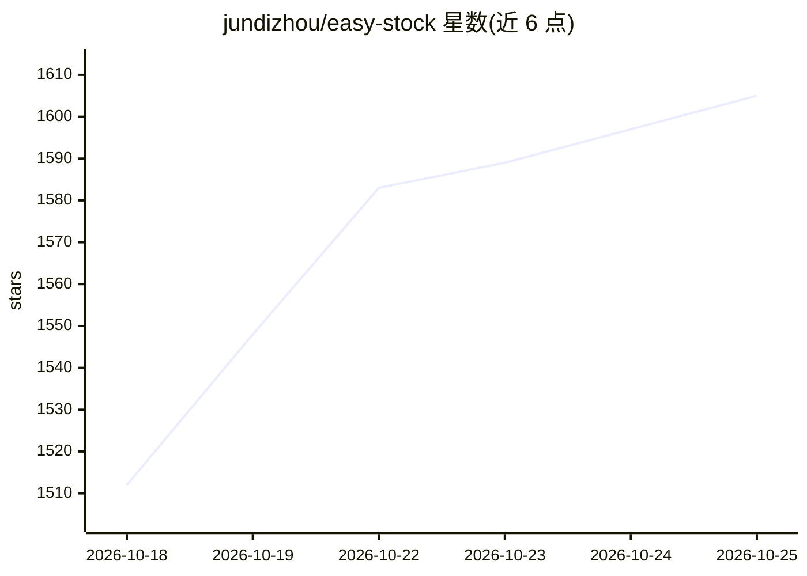

# jundizhou/easy-stock

⭐ 1,640 · Go · NOASSERTION · 推送 2026-10-25 · [GitHub](https://github.com/jundizhou/easy-stock) · [官网](https://github.com/jundizhou/easy-stock/blob/main/docs/user-guide.md) · 个人维护 · 中文 README

**A股 AI 智能投研桌面工作台：行情分析、复盘与持仓巡检**

面向 A 股个人投资者的 Electron 桌面应用：Go 后端聚合开盘啦、东方财富、新浪、财联社等多源行情与资讯，构建题材、连板梯队、情绪等可计算领域模型；上层提供大 V 自动复盘、超短连板分析、趋势题材雷达、个股分级 AI 研究、持仓巡检与 AI 持仓优化（不自动下单）。AI 部分经本机统一 Agent 服务选择 Hermes 或 Codex 运行时，可配置 OpenAI、DeepSeek、通义千问、Moonshot、Anthropic 及兼容接口。数据与研究记录本地保存（Local First，SQLite）。采用 PolyForm Noncommercial 许可，禁止未经许可的商业使用；从 GitHub Releases 下载安装包，无需安装 Node.js/Go/Python。

## 筛选速览

| 维度 | 判定 | 备注 |
|---|---|---|
| AI 角色 | `ai-native` | 本体是模型或模型工具 |
| 许可风险 | `none` | NOASSERTION |
| 部署形态 | `None` |  |
| 模型依赖 | locked-api |  |
| 硬件要求 | — | 无带数字的原话,不猜 |
| 安装摩擦 | `low` | 无编译、无系统依赖或容器化 |
| 成熟度 | — | 结构信号不足 |

## 能力要点

- 多源行情聚合与题材、连板梯队、情绪周期等领域模型
- 个股分级 AI 研究（速览/快速/标准/深度）与四维持仓巡检评分
- 大 V 文章自动同步、去重归档与跨作者观点共识提炼
- Hermes/Codex 双 Agent 运行时，支持 OpenAI/DeepSeek/通义千问/Moonshot/Anthropic 及兼容接口

## 适用场景

- 盘后自动收集多位大 V 复盘并生成观点共识与分歧地图
- 对持仓做 AI 巡检与组合评分，比较优化方案
- 盘中跟踪题材主线、连板梯队与市场情绪
- 按超短/波段/中期周期做个股分级研究

## 场景标签

`金融量化` · 领域:学习与行业

## 证据(README 行号)

> L46: easy-stock 希望构建一套真正理解 A股语境的 AI 原生工作台，把行情分析、题材研究、股票分析、盘后复盘与可追溯证据放进同一个本地优先的研究流程：
> L202: AI 会话经过本机统一 Agent 服务，可选择 Hermes 或 Codex 运行时。两者共享模型连接、思考强度、Skills 与 MCP 设置，分别管理原生会话；业务任务绑定运行时和模型配置，支持模型调用、会话续接、工具协作

## 星数曲线

2026-10-18 1,512 → 2026-10-25 1,605（+93）

---
*卡片 v1 · prompt 1.4 · 生成 2026-10-21 · 置信度 high · 依据 README sha `bc5a92190aed` · [字段定义](../../DATASET.md)*
