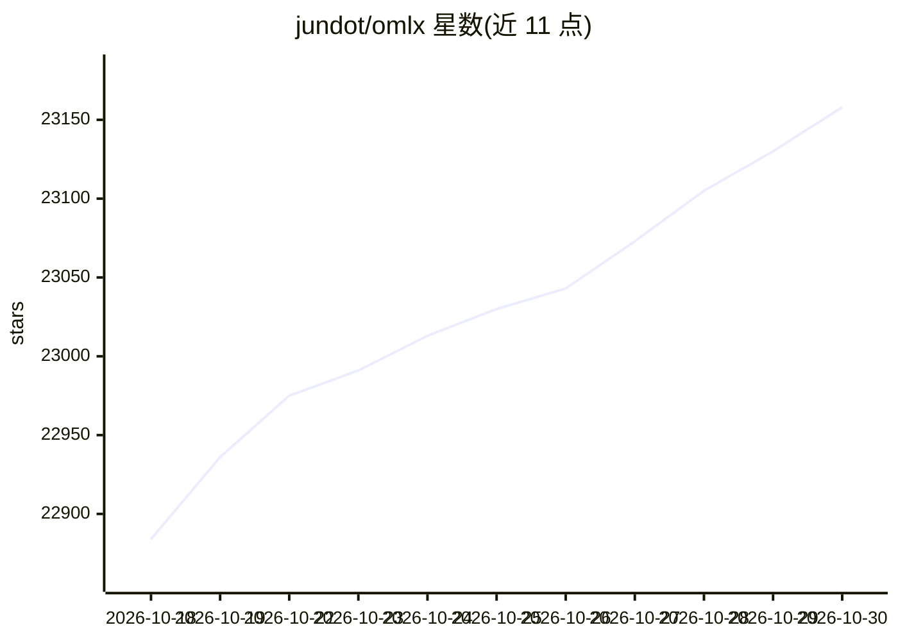

# jundot/omlx

⭐ 23,158 · Python · Apache-2.0 · 推送 2026-10-29 · [GitHub](https://github.com/jundot/omlx) · [官网](https://omlx.ai) · 个人维护 · 中文 README

**Apple Silicon 本地 LLM 推理服务器，菜单栏管理，含 SSD 分层 KV 缓存**

面向 Mac 用户的本地推理服务器：基于 MLX 支持文本 LLM、VLM、OCR、embedding 与 reranker 的多模型同服务器加载，提供连续批处理、块式分层 KV 缓存（热层 RAM + 冷层 SSD，重启后可复用）、LRU 逐出与模型固定等机制。API 兼容 OpenAI 与 Anthropic 端点，任何 OpenAI 兼容客户端可连 localhost:8000/v1。以原生 Swift 菜单栏应用管理，另有 Homebrew 与源码安装方式；要求 macOS 15+ 与 Apple Silicon（M1-M5），部分模型需完整 Xcode 编译原生自定义 kernel。实验性功能支持多台 Mac 分布式推理。

## 筛选速览

| 维度 | 判定 | 备注 |
|---|---|---|
| AI 角色 | `ai-ecosystem` | LLM/agent 周边工具 |
| 许可风险 | `permissive` | Apache-2.0 |
| 部署形态 | `desktop` | 安装包/桌面程序 |
| 模型依赖 | — | README 未给出锁定关系 |
| 硬件要求 | — | 无带数字的原话,不猜 |
| 安装摩擦 | `medium` | 含编译或系统依赖之一 |
| 成熟度 | `idea` | |

## 动量与使用信号

- 维护:`active` — 距上次 push 0.6 天,年发版 100,307 位贡献者
- 涨星:近 1 天 **+30**(自 20261016 起算)
- 安装:pypi 包 `mcp` 月下载 235,193,557
- 平台:MACOS / WEB · 协议:OPENAI-API / MCP

## 能力要点

- 分层 KV 缓存：热层 RAM + 冷层 SSD（safetensors 格式），重启后前缀可复用
- OpenAI/Anthropic API 兼容端点，含 chat/completions/embeddings/rerank/tokenize
- 多模型同服务器服务：LRU 逐出、模型固定、每模型 TTL 与内存上限（默认系统 RAM - 8GB）
- 原生 Swift/SwiftUI 菜单栏应用管理服务器，支持 OpenClaw/Codex/Copilot 等一键集成

## 适用场景

- 在 Mac 上本地运行 LLM/VLM 供 Claude Code、Codex 等编码工具调用
- 多模型同时服务并按内存自动管理加载与卸载
- 长上下文对话中跨请求复用 KV 缓存以降低重复计算

## 场景标签

`推理引擎` · 领域:训练与推理

## 证据(README 行号)

> L4:  LLM inference, optimized for your Mac Continuous batching and tiered KV caching, managed directly from your menu ba
> L93: The server discovers LLMs, VLMs, embedding models, and rerankers from subdirectories automatically. Any OpenAI-comp

## 星数曲线

2026-10-18 22,884 → 2026-10-30 23,158（+274）

---
*卡片 v1 · prompt 1.4 · 生成 2026-10-20 · 置信度 mid · 依据 README sha `36fcb2a35408` · [字段定义](../../DATASET.md)*
