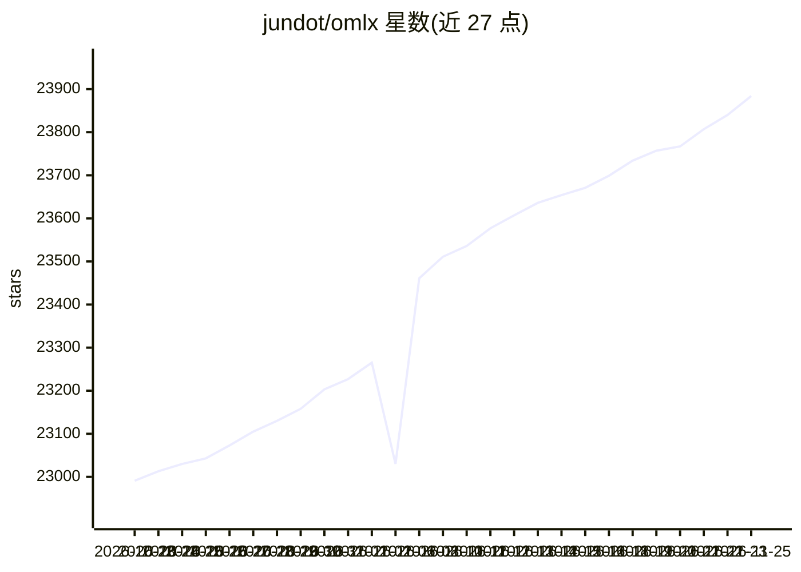

# jundot/omlx

⭐ 23,884 · Python · Apache-2.0 · 推送 2026-11-23 · [GitHub](https://github.com/jundot/omlx) · [官网](https://omlx.ai) · 个人维护 · 中文 README

**macOS 菜单栏管理的 Apple Silicon 本地 LLM 推理服务器**

面向 Apple Silicon Mac 的本地 LLM 推理服务器，支持文本 LLM、VLM、OCR、embedding 与 reranker 模型，核心机制包括连续批处理与热内存/冷 SSD 两级 KV 缓存（前缀共享、重启后可恢复）。提供 macOS 菜单栏应用、Homebrew 与源码三种安装方式，内置 Web 管理面板负责监控、多模型加载（LRU 驱逐/固定/TTL）与模型下载，对外暴露 OpenAI 兼容 API，并可一键接入多个编码 agent 客户端。要求 macOS 15.0+ 与 M 系列芯片。

## 筛选速览

| 维度 | 判定 | 备注 |
|---|---|---|
| AI 角色 | `ai-ecosystem` | LLM/agent 周边工具 |
| 许可风险 | `permissive` | Apache-2.0 |
| 部署形态 | `desktop` | 安装包/桌面程序 |
| 模型依赖 | — | README 未给出锁定关系 |
| 硬件要求 | — | 无带数字的原话,不猜 |
| 安装摩擦 | `high` | 编译与系统依赖俱全 |
| 成熟度 | — | 结构信号不足 |

## 动量与使用信号

- 维护:`active` — 距上次 push 0.6 天,年发版 100,307 位贡献者
- 涨星:近 1 天 **+30**(自 20261016 起算)
- 安装:pypi 包 `mcp` 月下载 235,193,557
- 平台:MACOS / WEB · 协议:OPENAI-API / MCP

## 能力要点

- 热 RAM + 冷 SSD 两级 KV 缓存，前缀跨请求与跨重启复用
- 连续批处理，兼容 OpenAI API 的客户端可直接连接
- 同一服务器混部 LLM/VLM/embedding/reranker，支持 LRU 驱逐、模型固定与 TTL
- 管理面板一键接入 OpenCode、Codex、Copilot CLI、Mistral Vibe 等客户端

## 适用场景

- 在 Mac 上本地运行多个模型并通过 OpenAI 兼容 API 提供服务
- 为 Claude Code、Codex 等编码工具配置本地模型后端
- 内存有限的 Mac 上通过 SSD 缓存运行更长上下文的对话
- 通过 Web 面板从 HuggingFace 搜索并下载模型

## 场景标签

`推理引擎` · 领域:训练与推理

## 证据(README 行号)

> L4:  LLM inference, optimized for your Mac Continuous batching and tiered KV caching, managed directly from your menu ba
> L94: The server discovers LLMs, VLMs, embedding models, and rerankers from subdirectories automatically. Any OpenAI-comp
> L57: Requires macOS 15.0+ (Sequoia), Python 3.11–3.13, and Apple Silicon (M1/M2/M3/M4/M5).

## 星数曲线

2026-10-23 22,991 → 2026-11-25 23,884（+893）

---
*卡片 v1 · prompt 1.4 · 生成 2026-11-24 · 置信度 mid · 依据 README sha `757421e4468c` · [字段定义](../../DATASET.md)*
