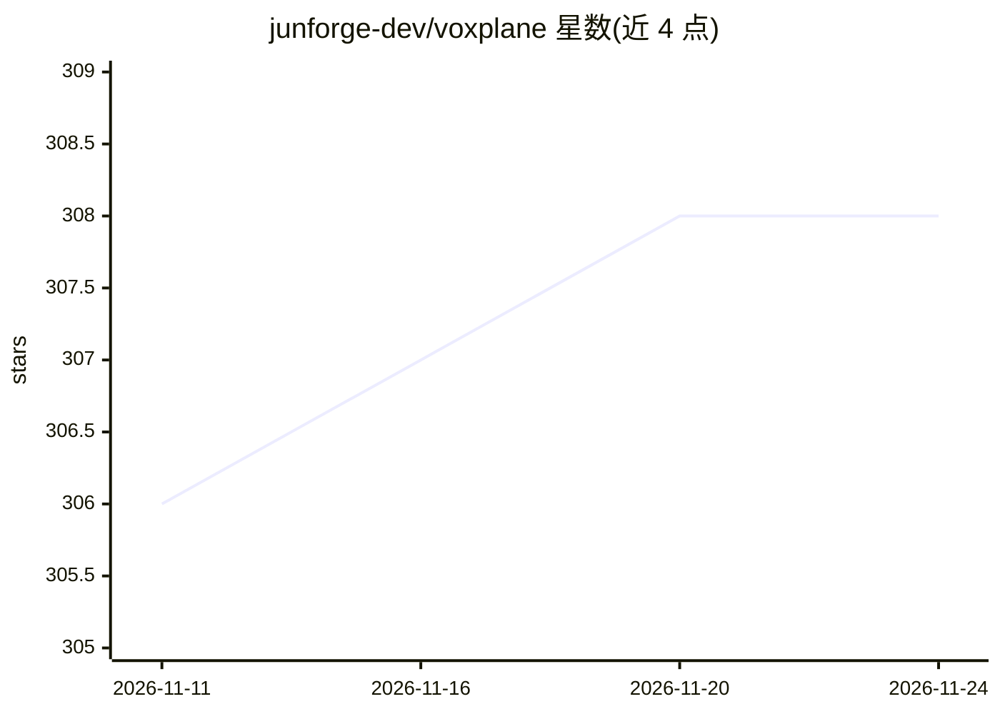

# junforge-dev/voxplane

⭐ 308 · Python · 推送 2026-11-13 · [GitHub](https://github.com/junforge-dev/voxplane) · [官网](https://junforge-dev.github.io/voxplane/) · 组织维护 · 中文 README

**面向 CT/MR/PET 的跨平台 DICOM 阅片工作台**

面向 CT、MR 与 PET 影像的跨平台 DICOM 桌面工作台，功能覆盖本地影像与压缩包导入、PACS（DICOMweb 与传统 DIMSE）查询下载、二维阅片与多序列对比、MPR/CPR/3D/4D 重建、PET/CT 融合、测量标注与分割 VOI、CT 质量分析（QA/MTF/FWHM）及多格式导出。AI 部分为连接用户已有 TotalSegmentator 环境进行本地 CT 多器官自动分割，结果可叠加查看、画笔精修并导出 SEG/NRRD。提供 macOS（含 Apple Silicon）与 Windows 安装包及便携版；开发者可从源码运行。

## 筛选速览

| 维度 | 判定 | 备注 |
|---|---|---|
| AI 角色 | `ai-enhanced` | 去掉 AI 部分产品仍成立 |
| 许可风险 | `none` | — |
| 部署形态 | `None` |  |
| 模型依赖 | — | README 未给出锁定关系 |
| 硬件要求 | — | 无带数字的原话,不猜 |
| 安装摩擦 | `medium` | 含编译或系统依赖之一 |
| 成熟度 | — | 结构信号不足 |

## 能力要点

- 三平面与斜面 MPR、手动 CPR、体绘制 3D 与 CT 多时相 4D
- PET/CT 融合含 SUV 显示与手动刚性配准
- 连接已有 TotalSegmentator 环境做本地 AI 多器官分割，结果可精修导出 SEG/NRRD
- 支持 DICOMweb 与传统 DIMSE（C-FIND/C-MOVE）的 PACS 查询与回传导入

## 适用场景

- 放射科阅片：MPR、3D 重建与多序列对比阅片
- PET/CT 融合阅片与 SUV 定量显示
- 放疗或科研场景做器官分割并精修导出
- 从院内 PACS 查询下载序列后本地阅片分析

## 场景标签

 · 领域:医学影像/放射诊断工具

## 证据(README 行号)

> L9: 面向 CT、MR 与 PET 的跨平台 DICOM 工作台，集阅片、三维重建、影像融合与测量分割于一体。支持 **基于 TotalSegmentator 的本地 AI 自动分割**，结果可直接查看、精修和保存。
> L40: |本地 AI|TotalSegmentator CT 多器官快速分割；器官搜索与选择、结果叠加、精修、撤销与保存。|

## 星数曲线

2026-11-11 306 → 2026-11-24 308（+2）

---
*卡片 v1 · prompt 1.4 · 生成 2026-11-17 · 置信度 high · 依据 README sha `e2ba59a08b43` · [字段定义](../../DATASET.md)*
