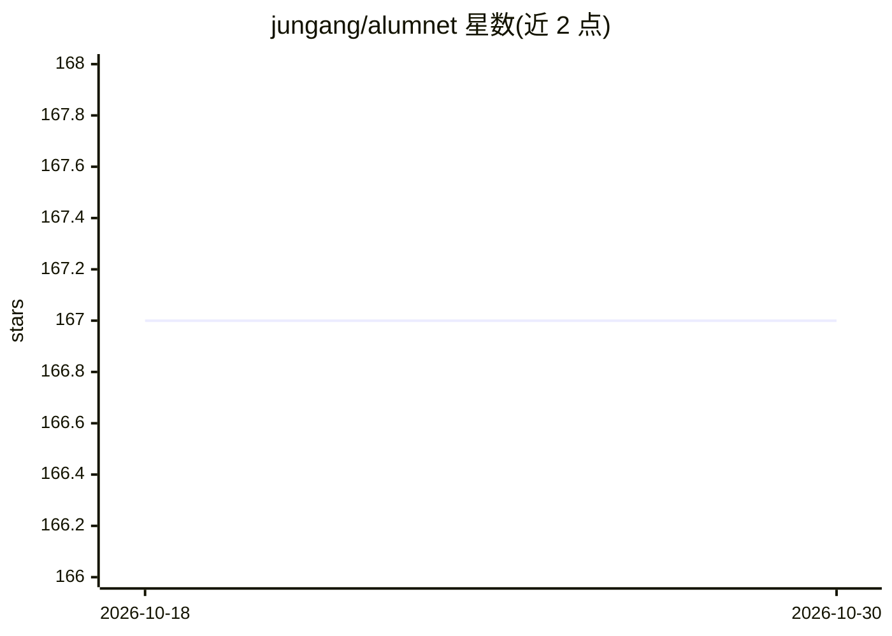

# jungang/alumnet

⭐ 167 · TypeScript · MIT · 推送 2026-07-20 · [GitHub](https://github.com/jungang/alumnet) · 个人维护 · 中文 README

**面向校史馆与校友会的开源校史展示与校友管理系统**

全栈开源系统，面向学校校史馆和校友会：Vue 3 + Three.js 触屏展厅（校友星图、时光长廊、老物件馆、荣誉墙）、Element Plus 管理后台（校友增删改查、Excel 批量导入导出、留言审核、一键备份）、RAG 架构的自然语言检索（Qdrant + pgvector，支持 GLM-4/DeepSeek/任意 OpenAI 兼容 API）。Docker Compose 一键部署，或 PM2 裸机运行；需 Node.js≥18、pnpm≥8、PostgreSQL≥14，Qdrant 与 AI API Key 为可选。

## 筛选速览

| 维度 | 判定 | 备注 |
|---|---|---|
| AI 角色 | `ai-enhanced` | 去掉 AI 部分产品仍成立 |
| 许可风险 | `permissive` | MIT |
| 部署形态 | `self-host` | docker 或自建部署 |
| 模型依赖 | locked-api |  |
| 硬件要求 | — | 无带数字的原话,不猜 |
| 安装摩擦 | `low` | 无编译、无系统依赖或容器化 |
| 成熟度 | — | 结构信号不足 |

## 能力要点

- Vue 3 + Three.js 触屏展厅：校友星图 3D 交互、时光长廊、荣誉墙
- RAG 自然语言检索，Qdrant + pgvector，支持 GLM-4/DeepSeek/OpenAI 兼容 API
- 管理后台支持校友数据 CRUD、Excel 批量导入导出、一键数据库备份
- Docker Compose 一键部署，含 Nginx 反代与 PM2 进程管理

## 适用场景

- 为母校校史馆部署触屏互动展示系统
- 校友会管理校友档案、毕业照、留言与捐赠记录
- 参观者用自然语言提问查询校友信息

## 场景标签

`语义搜索` · 领域:知识与检索

## 证据(README 行号)

> L46: - 🖥️ A **touch-screen kiosk** with sci-fi visual effects — alumni galaxies, time corridors, vintage museums
> L47: - 🤖 **AI-powered natural language search** — ask "哪些校友在医疗领域工作？" and get intelligent answers via RAG
> L48: - ⚙️ A **complete admin dashboard** — manage alumni data, photos, messages, donations, and more

## 星数曲线

2026-10-18 167 → 2026-10-30 167（+0）

---
*卡片 v1 · prompt 1.4 · 生成 2026-10-22 · 置信度 high · 依据 README sha `3b75c36caffa` · [字段定义](../../DATASET.md)*
