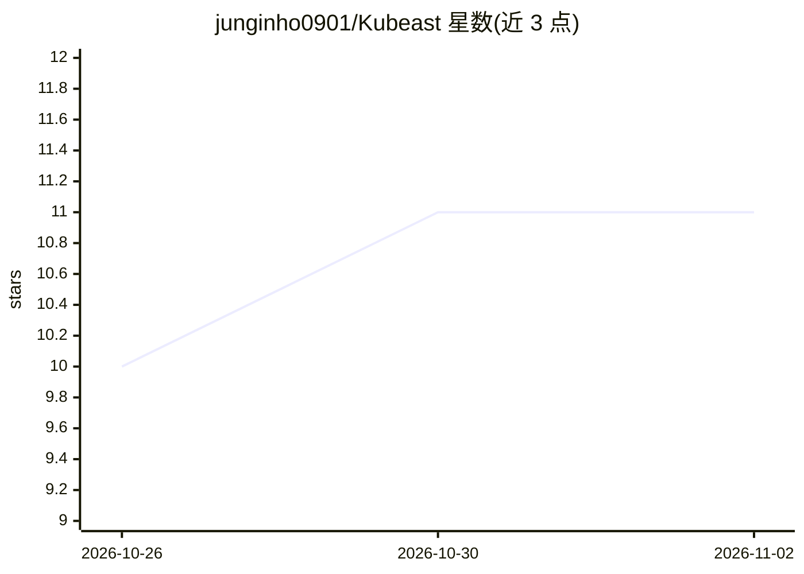

# junginho0901/Kubeast

⭐ 11 · TypeScript · MIT · 推送 2026-11-01 · [GitHub](https://github.com/junginho0901/Kubeast) · [官网](https://junginho0901.github.io/Kubeast/) · 个人维护 · 中文 README

**多集群 Kubernetes 控制台，内置按用户权限操作的 AI 助手**

自托管的多集群 Kubernetes 运维平台：Web UI 中跨集群查看与管理资源（工作负载、网络、存储、RBAC、GPU、Helm 等），并内置通过 tool calling 操作集群的 LLM 聊天助手，支持 OpenAI、Anthropic、Gemini、Azure OpenAI、Ollama。告警到达时 AI 用只读工具调查并留报告；AI 读取的密码/密钥/令牌在送入模型前被遮蔽；写操作经哈希链审计日志记录。通过 Helm 一行安装到 Kubernetes 或 Docker，提供 MCP server 供外部 AI agent 接入。

## 筛选速览

| 维度 | 判定 | 备注 |
|---|---|---|
| AI 角色 | `ai-enhanced` | 去掉 AI 部分产品仍成立 |
| 许可风险 | `permissive` | MIT |
| 部署形态 | `self-host` | docker 或自建部署 |
| 模型依赖 | local-ok | 支持本地模型 |
| 硬件要求 | — | 无带数字的原话,不猜 |
| 安装摩擦 | `low` | 无编译、无系统依赖或容器化 |
| 成熟度 | — | 结构信号不足 |

## 能力要点

- 多集群资源管理与按用户/按集群的 RBAC 及临时访问审批
- AI 助手通过 tool calling 查看、诊断与变更集群资源
- Alertmanager/Grafana 告警触发 AI 只读调查并生成报告
- 敏感信息在到达模型前遮蔽；哈希链审计日志与会话录像

## 适用场景

- 跨多个 Kubernetes 集群统一管理和诊断资源
- 告警到达后让 AI 自动调查并输出报告
- 在不暴露密钥的前提下用对话方式操作集群

## 场景标签

`AI 助手` · 领域:对话与助手

## 证据(README 行号)

> L5: A multi-cluster Kubernetes operations platform with a built-in AI assistant. In the web UI you can view and manage r
> L13: - AI assistant with multiple LLMs (OpenAI, Anthropic, Gemini, Azure OpenAI, Ollama) that operates clusters through 

## 星数曲线

2026-10-26 10 → 2026-11-02 11（+1）

---
*卡片 v1 · prompt 1.4 · 生成 2026-11-02 · 置信度 high · 依据 README sha `577f893193ee` · [字段定义](../../DATASET.md)*
