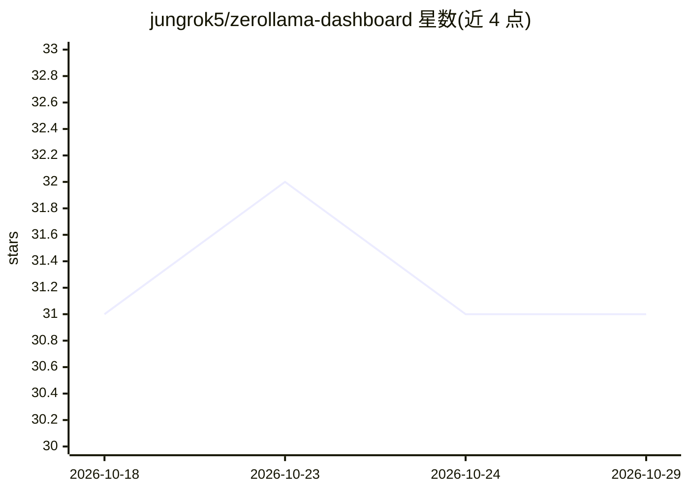

# jungrok5/zerollama-dashboard

⭐ 31 · HTML · NOASSERTION · 推送 2026-09-20 · [GitHub](https://github.com/jungrok5/zerollama-dashboard) · [官网](https://jungrok5.github.io/zerollama-dashboard/) · 个人维护

**单 HTML 文件的 llama.cpp 服务器监控面板，带聊天面板**

面向 llama.cpp 运维的单文件 HTML 监控仪表盘：实时读取 llama-server 的 /metrics 与 /slots 端点，展示生成速度、请求队列与各 slot 的完整采样配置；在服务器压力异常时给出调节建议（如提高 --parallel）。自动识别单模型与多模型 router 模式，内置聊天面板可发送流式 prompt 并观察指标反应，支持追踪 server.log，提供 5 种界面语言与内置 mock 服务器的在线演示。零依赖，仅需 llama-server 开启 --metrics。除指向的 llama-server URL 外不发送任何数据。

## 筛选速览

| 维度 | 判定 | 备注 |
|---|---|---|
| AI 角色 | `ai-ecosystem` | LLM/agent 周边工具 |
| 许可风险 | `none` | NOASSERTION |
| 部署形态 | `None` |  |
| 模型依赖 | local-ok | 支持本地模型 |
| 硬件要求 | — | 无带数字的原话,不猜 |
| 安装摩擦 | `low` | 无编译、无系统依赖或容器化 |
| 成熟度 | — | 结构信号不足 |

## 能力要点

- 实时展示各 slot 请求状态与采样参数（temperature/top_k/top_p/mirostat 等）
- 压力异常时给出调节哪个选项的白话提示
- 自动识别单模型与多模型 router 模式
- 内置流式聊天面板与 server.log 追踪，零依赖单 HTML 文件

## 适用场景

- 运行 llama.cpp 服务时实时观察 slot 占用与队列状态
- 不知道该调哪个参数时看白话调优提示
- 在同一页面边发 prompt 边看指标反应

## 场景标签

`LLM 可观测性` · 领域:评测与运维

## 证据(README 行号)

> L3: A single-HTML monitoring dashboard for llama.cpp
> L22: gap: a focused operator view of `/metrics` + `/slots` with prescriptive
> L47: You'll need a reasonably recent llama-server started with `--metrics`.

## 星数曲线

2026-10-18 31 → 2026-10-29 31（+0）

---
*卡片 v1 · prompt 1.4 · 生成 2026-10-26 · 置信度 high · 依据 README sha `aeb7b6cae03c` · [字段定义](../../DATASET.md)*
