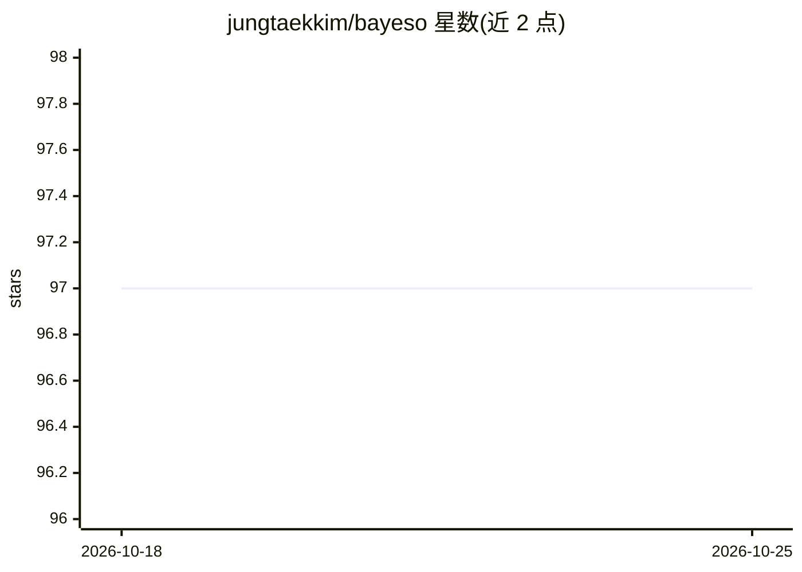

# jungtaekkim/bayeso

⭐ 97 · Python · MIT · 推送 2026-01-12 · [GitHub](https://github.com/jungtaekkim/bayeso) · [官网](https://bayeso.org) · 个人维护

**Python 贝叶斯优化库：用于黑盒函数与超参数优化**

BayesO 是一个用 Python 编写的贝叶斯优化软件包，定位为 Simple, but essential，提供黑盒函数优化能力，常用于机器学习超参数优化场景，配套在线文档、示例与测试。安装途径包括 PyPI 仓库（pip install bayeso）与源码安装（含可编辑开发模式），支持 Python 3.8–3.12，MIT 许可证发布。作者发表 JOSS 论文可供引用。

## 筛选速览

| 维度 | 判定 | 备注 |
|---|---|---|
| AI 角色 | `ai-native` | 本体是模型或模型工具 |
| 许可风险 | `permissive` | MIT |
| 部署形态 | `library` | 以包/库形式分发 |
| 模型依赖 | — | README 未给出锁定关系 |
| 硬件要求 | — | 无带数字的原话,不猜 |
| 安装摩擦 | `low` | 无编译、无系统依赖或容器化 |
| 成熟度 | — | 结构信号不足 |

## 能力要点

- 提供贝叶斯优化框架，Python 库形式
- 支持 Python 3.8–3.12，附带示例与测试
- 通过 PyPI 与源码两种方式安装，MIT 许可

## 适用场景

- 优化机器学习模型的超参数
- 对黑盒目标函数执行贝叶斯优化
- 科研实验中作可复现的优化基线库

## 场景标签

 · 领域:机器学习/优化

## 证据(README 行号)

> L1: # BayesO: A Bayesian Optimization Framework in Python
> L9: Simple, but essential Bayesian optimization package.

## 星数曲线

2026-10-18 97 → 2026-10-25 97（+0）

---
*卡片 v1 · prompt 1.4 · 生成 2026-10-23 · 置信度 high · 依据 README sha `5db88b0794de` · [字段定义](../../DATASET.md)*
